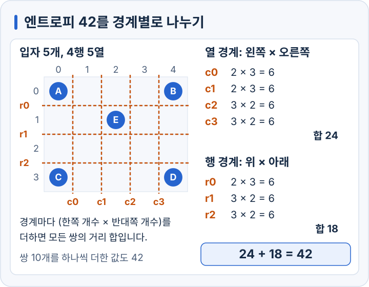

# 특수한 점수식 읽기: 문제 계약과 점수식의 구조

ENTROPY2D의 입력·행동·예산 계약, 채점식을 내 코드로 옮겨 손계산·내 점수·채점기 점수를 맞추는 재현, 상수 항과 축별 분리로 보는 점수식의 구조와 하한을 다룹니다. 전체 흐름은 [강의 개요](../lesson.md)에 있습니다.

## 문제 계약을 상태로 옮기기

이름만 보고 "입자 사이 거리 합을 줄이면 점수"라고 짐작하면 세 군데가 어긋납니다. 점수는 거리 합이 아니라 **줄어든 비율의 제곱**이고, 규칙을 어긴 호출은 TC를 무효로 만들지 않고 **횟수만 쓰며**, 남은 이동 횟수가 **보너스 점수**가 됩니다.

| 항목 | 계약 |
| --- | --- |
| 구현 | TC마다 `process()`를 한 번 부릅니다. 입력 인자는 없고 API로 읽습니다. TC 10개, 시간 제한 10초 |
| 규모 | 높이·너비 각각 80~180, 입자 밀도 30~50%. 공개 TC 10개는 격자 96×89~178×143, 입자 3105~9906개 |
| 읽기 | `getHeight`, `getWidth`, `getParticleCount`, `getMoveLimit`, `getMoveCount`, `getCell(y, x)`(0 빈 칸, 1 입자, -1 격자 밖). 읽기는 횟수에 세지 않습니다. |
| 행동 | `moveParticle(y, x, dir)`: 입자를 한 칸 옮깁니다. `dir` 0 위(y-1), 1 오른쪽(x+1), 2 아래, 3 왼쪽. 성공 1, 실패 0 |
| 예산 | 한도 `H × W × 40`(공개 TC 341760~1084160). 호출마다 사용 횟수가 1 늘고 **실패한 호출도 셉니다.** |
| 점수 | 아래 식. 클수록 좋고 10개 TC 합이 총점입니다. 통과 기준은 1917000 |

| 호출 | 반환 | 사용 횟수 |
| --- | --- | --- |
| 한도에 닿은 뒤의 모든 호출 | 0 | 늘지 않음 |
| 좌표 밖, 입자 없는 칸, 방향이 0~3 밖 | 0 | 늘어남 |
| 목적지가 격자 밖이거나 이미 입자가 있음 | 0 | 늘어남 |
| 그 밖 | 1, 입자 이동 | 늘어남 |

어떤 호출도 TC를 0점으로 만들지 않고 예산만 씁니다. 점수는 `process`가 끝난 뒤 한 번 계산합니다.

```text
E = 모든 입자 쌍(i < j)의 |dy| + |dx| 합        E0는 process 시작 때의 E
점수 = floor(1000000 × (max(0, E0 − E) / E0)²) + floor((한도 − 사용 횟수) / 100)
```

입자는 서로 구별되지 않으므로 상태는 입자 목록 `py, px`, 점유 격자 `occ`, 사용 횟수가 전부입니다. `occ`와 목록은 채점기 상태를 따라 그린 **거울**이며, 한 곳(`act`)에서만 갱신합니다. 행동 전에 `occ`로 막으면 실패 호출로 예산을 쓰지 않습니다. 입자 수는 최대 180×180 = 32400이라 배열 상한이 되고, 초기화는 `process` 시작의 `init`에서 한 번 합니다.

> **코드 환경: h-contest 제출용.** `ent-state`, `ent-score`, `ent-axis`, `ent-act`를 이 순서로 `user.cpp`에 붙이고 마지막에 단계별 `process`를 하나 붙입니다. 2단계 이상은 `ent-greedy`를, 4단계는 `ent-relocate`도 먼저 붙입니다. 5단계는 `ent-greedy`와 `ent-relocate` 없이 `ent-target`, `ent-match`를 이 순서로 붙입니다.

```cpp snippet=ent-state
extern int getHeight();
extern int getWidth();
extern int getParticleCount();
extern long long getMoveLimit();
extern long long getMoveCount();
extern int getCell(int y, int x);
extern int moveParticle(int y, int x, int dir);

namespace ent {
const int MAXHW = 180, MAXN = MAXHW * MAXHW;
const int DY[4] = {-1, 0, 1, 0};
const int DX[4] = {0, 1, 0, -1};

struct World {
    int H, W, n;
    bool occ[MAXHW][MAXHW];          // 내가 기록한 점유
    int py[MAXN], px[MAXN];          // i번 입자의 위치
    int preY[MAXHW], preX[MAXHW];    // preY[r] = 행이 r 이하인 입자 수, preX[c]도 같은 뜻
    long long used, limit;           // 지금까지 부른 횟수(실패 포함), 한도
    long long e0, entropy;           // 시작 엔트로피, 내가 따라가는 현재 엔트로피
    int refused, mismatch;           // 내가 막은 요청 수, 채점기 반환값이 예측과 달랐던 수
};
World G;
long long mirrorScore;
void (*hook)(long long score, long long e0, long long e, long long used, int refused, int mismatch);
}
```

## 채점식을 내 코드로 재현하기

`ent-score`는 채점기의 두 함수를 그대로 따라 쓴 것입니다. 이후 모든 검사는 `myScore`가 채점기 점수와 같다는 데서 출발하므로, 빠른 식은 나중에 만들고 먼저 느려도 문장 그대로 쓴 식을 둡니다.

```cpp snippet=ent-score
namespace ent {
// 채점기 calc_entropy를 그대로 옮긴 O(n^2). 쌍마다 한 번(i < j)이고 누적은 long long이다.
long long entropyPairs() {
    long long e = 0;
    for (int i = 0; i < G.n; ++i)
        for (int j = i + 1; j < G.n; ++j) {
            int dy = G.py[i] - G.py[j]; if (dy < 0) dy = -dy;
            int dx = G.px[i] - G.px[j]; if (dx < 0) dx = -dx;
            e += dy + dx;
        }
    return e;
}

// 채점기 verify를 그대로 옮긴 점수. 나눗셈 두 곳과 형 변환 위치까지 같게 쓴다.
long long myScore(long long e0, long long e, long long used, long long limit) {
    long long improvement = e0 - e;
    if (improvement < 0) improvement = 0;
    double ratio = (double)improvement / (double)e0;
    long long entropyScore = (long long)(1000000.0 * ratio * ratio);
    long long moveBonus = (limit - used) / 100;
    return entropyScore + moveBonus;
}
}
```

옮길 때 어긋나기 쉬운 곳과, 틀리면 어떻게 달라지는지입니다.

| 지점 | 채점기 | 틀리게 쓰면 |
| --- | --- | --- |
| 쌍 | `i < j`로 한 번씩 | 두 번 세면 E가 2배가 되지만 점수는 **그대로**입니다. 비율이라 숨습니다. |
| 누적 자료형 | `long long` | 공개 TC 10개 중 4개(TC 4·5·9·10)의 E0가 2³¹을 넘어서 `int`면 깨집니다. |
| 비율 | `(double)improvement / (double)E0` | 정수 나눗셈이면 항상 0이 됩니다. |
| 소수 버림 | `(long long)(1000000.0 × r × r)` | 반올림이 아니라 버림입니다. |
| 보너스 | `(한도 − 사용) / 100` 정수 나눗셈 | 반올림하면 최대 1점이 다릅니다. 사용 횟수는 **실패 호출 포함**입니다. |
| 음수 | `improvement < 0`이면 0 | E가 늘어난 TC도 엔트로피 점수는 0이고 보너스만 남습니다. |

손으로 계산할 수 있는 TC로 세 값을 맞춥니다. 4행 5열 격자에 입자 5개 `A(0,0) B(0,4) C(3,0) D(3,4) E(1,2)`가 있고 한도는 `4 × 5 × 40 = 800`입니다. 모든 쌍의 거리는 다음과 같습니다.

| 쌍 | AB | AC | AD | AE | BC | BD | BE | CD | CE | DE |
| --- | --- | --- | --- | --- | --- | --- | --- | --- | --- | --- |
| 거리 | 4 | 3 | 7 | 3 | 7 | 3 | 3 | 4 | 4 | 4 |

합 E0 = 42입니다. 호출 세 번을 합니다. A를 오른쪽으로(성공, E = 40), B를 오른쪽으로(격자 밖이라 실패), C를 위로(성공, E = 38). 이 순서가 아래 `process`입니다(채점기에 붙여 돌리는 확인용 코드이며 제출 코드가 아닙니다).

```cpp snippet=ent-hand
extern int moveParticle(int y, int x, int dir);

void process() {
    moveParticle(0, 0, 1);   // (0,0)의 입자를 오른쪽으로: 성공
    moveParticle(0, 4, 1);   // (0,4)의 입자를 오른쪽으로: 격자 밖이라 실패, 횟수는 센다
    moveParticle(3, 0, 0);   // (3,0)의 입자를 위로: 성공
}
```

손계산은 `improvement = 4`, `r = 4/42`, `r²×10⁶ = 9070.29`를 버려 9070, 보너스는 `(800 − 3)/100 = 7.97`을 버려 7이라 **9077**입니다. 두 번째 호출이 실패해도 횟수 3에 들어간다는 점이 핵심입니다. 같은 값을 `myScore(42, 38, 3, 800)`과 채점기가 내야 합니다. 채점기는 `init()`만 이 격자로 바꾼 사본(출력 줄 추가 포함)으로 돌립니다. `scripts/check_reading_the_score.py --judge`가 이 세 값이 모두 9077인지 확인하고, 기본 검사는 점수 계산을 이 강의 코드로 다시 돌려 확인합니다.

[경계 차분 데모: 입자 이동과 점수 계산](https://git.readiz.com/h-contest-lesson/demos/index.html?demo=boundary-delta)

엔트로피를 열·행 경계의 (한쪽 개수 × 반대쪽 개수) 합으로 보고, 입자를 옮길 때 경계 값 하나만 바뀌는 차분식과 전체 재계산을 나란히 비교합니다. 입자와 방향을 바꿔 격자 밖으로 나가는 실패 호출도 시도해 보세요.

## 점수식의 구조: 상수 항, 축별 분리, 경계

점수는 `f(E) + g(사용 횟수)`입니다. `E0`와 한도는 내 행동과 무관한 **상수**이고, 내 행동으로 바뀌는 것은 E와 사용 횟수뿐입니다. 거리 합의 구조가 풀이를 결정합니다.



[그림 크게 보기](https://git.readiz.com/h-contest-lesson/lessons/reading-the-score/lesson-assets/axis-split.svg)

- **축별 분리.** `|dy| + |dx|`의 합은 y만의 합과 x만의 합으로 갈립니다. 입자의 열 분포만 알면 x 몫이, 행 분포만 알면 y 몫이 정해집니다.
- **경계 식.** 두 입자의 열 거리는 둘을 가르는 열 경계의 수입니다. 열 경계 `c`(열 c와 c+1 사이)를 가르는 쌍은 왼쪽 개수 × 오른쪽 개수이므로 `E = Σ pre[c] × (n − pre[c])`를 행과 열에 대해 더합니다. `pre`는 개수의 누적합이라 **O(n²) 대신 O(H + W)**입니다. 위 그림이 이 계산입니다.
- **하한.** 열 하나에는 최대 H개, 행 하나에는 최대 W개 입자가 들어갑니다. 각 축을 따로 가장 모으면(꽉 찬 열을 한쪽부터 채우면) 합이 가장 작습니다. 이 값은 E의 **하한**이고, 작은 경우를 모든 열 개수 조합으로 전수 조사해 식을 검산합니다.
- **상한 없음, 보너스는 선형.** 점수는 감소 비율의 제곱이라 감소가 클수록 한 단위의 가치가 커지고, 보너스는 이동 한 번에 `0.01`점입니다. 이동이 E를 `g`만큼 줄이면 점수는 `2×10⁶ × r × g / E0`(r은 지금의 감소율) 늘어납니다. 이 값이 0.01보다 작아지면 이동은 손해입니다. 공개 TC에서 r을 0.41~0.46으로 두면 이동 한 번에 `g ≥ 0.01 × E0 / (2×10⁶ × r)`가 필요하고, TC 1은 약 8.9, TC 10은 약 65.6입니다. 입자 수가 늘면 E0가 n²로 커지므로 TC마다 문턱이 크게 다릅니다.

```cpp snippet=ent-axis
namespace ent {
// 행·열 개수의 누적합. 입자 하나가 한 칸 움직이면 누적합 한 칸만 바뀐다.
void buildPre() {
    for (int r = 0; r < G.H; ++r) G.preY[r] = 0;
    for (int c = 0; c < G.W; ++c) G.preX[c] = 0;
    for (int i = 0; i < G.n; ++i) { ++G.preY[G.py[i]]; ++G.preX[G.px[i]]; }
    for (int r = 1; r < G.H; ++r) G.preY[r] += G.preY[r - 1];
    for (int c = 1; c < G.W; ++c) G.preX[c] += G.preX[c - 1];
}

// 엔트로피 = 행 경계마다 (위 개수 x 아래 개수)의 합 + 열 경계마다 (왼쪽 x 오른쪽)의 합. O(H + W)
long long entropyAxis() {
    long long e = 0;
    for (int r = 0; r + 1 < G.H; ++r) e += (long long)G.preY[r] * (G.n - G.preY[r]);
    for (int c = 0; c + 1 < G.W; ++c) e += (long long)G.preX[c] * (G.n - G.preX[c]);
    return e;
}

// (y, x)의 입자를 dir로 한 칸 옮길 때 엔트로피 변화량. 음수면 좋아진다. O(1)
long long delta(int y, int x, int dir) {
    long long n = G.n;
    if (dir == 0) return n - 1 - 2LL * (y > 0 ? G.preY[y - 1] : 0);
    if (dir == 1) return 2LL * G.preX[x] - 1 - n;
    if (dir == 2) return 2LL * G.preY[y] - 1 - n;
    return n - 1 - 2LL * (x > 0 ? G.preX[x - 1] : 0);
}
}
```
