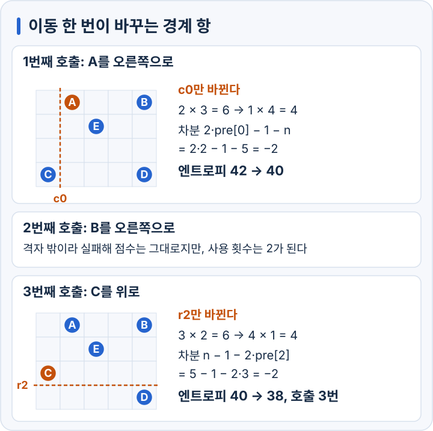

# 특수한 점수식 읽기: 풀이

이동 한 번의 O(1) 차분식을 만들고, 0단계 기준선에서 중앙으로 밀기, 차분 탐욕, 큰 이득부터, 빈 칸 경로 재배치, 목표 배치 짝짓기까지 단계별로 키웁니다. 앞 단계는 [문제 계약과 점수식의 구조](contract-and-baseline.md)입니다.

## 차분식: 이동 한 번의 변화를 O(1)로

입자가 열 x에서 x+1로 가면 열 x 이하의 다른 입자(`pre[x] − 1`개)와는 1 멀어지고, 열 x+1 이상의 입자(`n − pre[x]`개)와는 1 가까워집니다. 변화량은 `2·pre[x] − 1 − n`이고, 경계 식으로 보면 경계 `x`의 값 하나만 `pre·(n − pre)`에서 `(pre−1)(n − pre + 1)`로 바뀐 것입니다. 왼쪽은 `n − 1 − 2·pre[x−1]`이고 위·아래도 같은 모양입니다(`delta`). 이동 뒤에는 누적합도 한 칸만 바뀝니다. 손계산 TC에서 두 방법으로 비교합니다. A를 오른쪽으로 옮기면 차분은 `2·pre[0] − 1 − 5 = −2`이고 전체 재계산도 42 → 40으로 −2입니다. C를 위로 옮기면 차분 `5 − 1 − 2·pre[2] = −2`, 전체 재계산 40 → 38로 같습니다.



[그림 크게 보기](https://git.readiz.com/h-contest-lesson/lessons/reading-the-score/lesson-assets/one-move.svg)

전체 재계산(`entropyPairs`)과의 대조는 하네스가 합니다. 기준 채점기를 따로 만들어 `moveParticle`이 불릴 때마다 거울의 엔트로피와 기준 O(n²) 계산이 같은지 확인하고, 무작위 격자 30개에서 합법 이동 4861개의 `delta`가 이동 전후의 O(n²) 차이와 같은지 봅니다. 아래 `act`가 모든 이동을 지나는 통로입니다.

```cpp snippet=ent-act
namespace ent {
void init() {
    G.H = getHeight(); G.W = getWidth(); G.n = 0;
    for (int y = 0; y < G.H; ++y)
        for (int x = 0; x < G.W; ++x) {
            G.occ[y][x] = getCell(y, x) == 1;
            if (G.occ[y][x]) { G.py[G.n] = y; G.px[G.n] = x; ++G.n; }
        }
    G.used = getMoveCount(); G.limit = getMoveLimit();
    G.refused = G.mismatch = 0;
    buildPre();
    G.entropy = G.e0 = entropyAxis();
}

bool canMove(int y, int x, int dir) {
    if (G.used >= G.limit) return false;
    int ny = y + DY[dir], nx = x + DX[dir];
    return 0 <= ny && ny < G.H && 0 <= nx && nx < G.W && !G.occ[ny][nx];
}

// 채점기를 부르는 유일한 통로. 호출 전에 내 점유 격자로 먼저 거른다.
bool act(int i, int dir) {
    int y = G.py[i], x = G.px[i];
    if (!canMove(y, x, dir)) { ++G.refused; return false; }
    int ok = moveParticle(y, x, dir);
    ++G.used;                                  // 실패해도 채점기는 횟수를 센다
    if (!ok) { ++G.mismatch; return false; }
    G.entropy += delta(y, x, dir);             // 누적합을 바꾸기 전에 계산한다
    if (dir == 0) ++G.preY[y - 1];
    else if (dir == 1) --G.preX[x];
    else if (dir == 2) --G.preY[y];
    else ++G.preX[x - 1];
    G.occ[y][x] = false;
    G.py[i] = y + DY[dir]; G.px[i] = x + DX[dir];
    G.occ[G.py[i]][G.px[i]] = true;
    return true;
}

void finish() {
    mirrorScore = myScore(G.e0, G.entropy, G.used, G.limit);
    if (hook) hook(mirrorScore, G.e0, G.entropy, G.used, G.refused, G.mismatch);
}
}
```

## 단계별 풀이

0단계는 아무것도 하지 않는 기준선입니다. 유효하며 점수는 보너스뿐입니다.

```cpp snippet=ent-baseline
void process() {
    ent::init();      // 아무 행동도 하지 않는다
    ent::finish();
}
```

1단계는 점수식을 모르는 탐욕으로, 모든 입자를 격자 중앙 쪽으로 한 칸씩 밉니다. 막히면 그 입자는 건너뜁니다(`act`가 거절하고 `refused`가 늘어납니다).

```cpp snippet=ent-naive
// 점수식을 쓰지 않는 탐욕: 입자를 격자 중앙 쪽으로 한 칸씩 민다.
void process() {
    ent::init();
    int cy = (ent::G.H - 1) / 2, cx = (ent::G.W - 1) / 2;
    for (bool moved = true; moved && ent::G.used < ent::G.limit; ) {
        moved = false;
        for (int i = 0; i < ent::G.n; ++i) {
            int dy = cy - ent::G.py[i], dx = cx - ent::G.px[i];
            int dir = (dy < 0 ? -dy : dy) >= (dx < 0 ? -dx : dx) ? (dy < 0 ? 0 : 2) : (dx > 0 ? 1 : 3);
            if ((dy || dx) && ent::act(i, dir)) moved = true;
        }
    }
    ent::finish();
}
```

2단계는 차분식을 씁니다. 입자마다 네 방향 중 E를 가장 많이 줄이는 합법 이동을 고르고, 더 줄일 수 없을 때까지 훑습니다. 중앙이 아니라 **입자의 중앙값(누적합)** 이 기준이 되므로 격자 중앙을 몰라도 됩니다. 3단계는 같은 차분으로 이득이 큰 이동부터 합니다. 문턱 `t`를 n에서 시작해 `KEEP/8`배씩 줄이며, 각 문턱에서 더 움직일 수 없을 때까지 훑습니다.

```cpp snippet=ent-greedy
namespace ent {
const int KEEP = 6;            // 큰 이득부터 할 때 문턱을 KEEP/8배씩 줄인다

// i번 입자가 지금 둘 수 있는 이동 중 가장 많이 줄이는 방향. minGain만큼 못 줄이면 -1
int bestDir(int i, long long minGain) {
    int best = -1; long long bestDelta = 0;
    for (int d = 0; d < 4; ++d) {
        if (!canMove(G.py[i], G.px[i], d)) continue;
        long long dl = delta(G.py[i], G.px[i], d);
        if (dl <= -minGain && dl < bestDelta) { bestDelta = dl; best = d; }
    }
    return best;
}

// 입자를 번호 순서로 한 번씩 훑는다. 움직인 입자 수를 돌려준다.
int sweep(long long minGain) {
    int moved = 0;
    for (int i = 0; i < G.n; ++i) {
        int d = bestDir(i, minGain);
        if (d >= 0 && act(i, d)) ++moved;
    }
    return moved;
}

// 문턱 t 이상 줄이는 이동만, 더 못 움직일 때까지 훑는다. t를 n에서 1까지 줄인다.
void thresholdSweeps() {
    for (long long t = G.n; t >= 1 && G.used < G.limit; t = t == 1 ? 0 : (t * KEEP / 8 > 0 ? t * KEEP / 8 : 1))
        while (G.used < G.limit && sweep(t) > 0) {}
}
}
```

2단계의 `process`는 `while (ent::G.used < ent::G.limit && ent::sweep(1) > 0) {}`로 1 이상 줄이는 이동을 모두 허용해 훑는 것이고 3단계는 `ent::thresholdSweeps()`를 부릅니다. 두 `process`는 `init`과 `finish` 사이만 다릅니다.

```cpp snippet=ent-entry-greedy
void process() {
    ent::init();
    while (ent::G.used < ent::G.limit && ent::sweep(1) > 0) {}
    ent::finish();
}
```

```cpp snippet=ent-entry-threshold
void process() {
    ent::init();
    ent::thresholdSweeps();
    ent::finish();
}
```

두 단계는 모두 이동 한도의 26%만 쓰고 멈춥니다. 남은 입자는 E를 줄이는 방향의 칸이 **막혀** 있습니다(작은 격자 검사에서 멈춘 상태에 E를 줄이는 합법 이동이 없음을 확인합니다). 한 칸 이동으로는 닿지 못하지만 빈 칸을 돌아가면 닿는 자리가 있습니다. 그래서 4단계는 입자 하나를 빈 칸만 지나 옮깁니다. a에서 b로 옮길 때의 변화는 각 축의 거리 합 `F`로 O(1)에 구합니다. `Fx[c]`는 모든 입자와 열 c의 열 거리 합이고, `F(c+1) = F(c) + 2·pre[c] − n`으로 누적합에서 만듭니다. 자기 자신과의 거리를 빼면 `ΔE = F(b) − |b − a| − F(a)`입니다. 빈 칸만 지나는 BFS로 후보 칸을 모으고, 이동당 `MINPER` 이상 줄이는 칸 중 가장 많이 줄이는 곳으로 보냅니다. 이 차분식도 전체 재계산과 대조합니다(무작위 3049개).

```cpp snippet=ent-relocate
namespace ent {
const long long MINPER = 10;       // 이동 한 번당 이만큼 이상 줄어야 옮긴다
long long Fx[MAXHW], Fy[MAXHW];    // Fx[c] = 모든 입자와 열 c의 열 거리 합, Fy[r]은 행 버전
int dist[MAXHW][MAXHW], from[MAXHW][MAXHW], que[MAXN];

// F(c + 1) = F(c) + 2 pre[c] - n 으로 누적합에서 만든다.
void buildF() {
    long long sx = 0, sy = 0;
    for (int c = 0; c < G.W; ++c) sx += (long long)c * (G.preX[c] - (c ? G.preX[c - 1] : 0));
    for (int r = 0; r < G.H; ++r) sy += (long long)r * (G.preY[r] - (r ? G.preY[r - 1] : 0));
    Fx[0] = sx; Fy[0] = sy;
    for (int c = 0; c + 1 < G.W; ++c) Fx[c + 1] = Fx[c] + 2LL * G.preX[c] - G.n;
    for (int r = 0; r + 1 < G.H; ++r) Fy[r + 1] = Fy[r] + 2LL * G.preY[r] - G.n;
}

int absv(int v) { return v < 0 ? -v : v; }

// a에서 b로 옮겼을 때 엔트로피 변화량. b의 F에서 자기 자신과의 거리 |b - a|를 뺀다.
long long relocateDelta(int ay, int ax, int by, int bx) {
    return Fx[bx] + Fy[by] - absv(bx - ax) - absv(by - ay) - Fx[ax] - Fy[ay];
}

// i번 입자를 빈 칸만 지나 갈 수 있는 가장 좋은 칸으로 보낸다. 옮겼으면 true
bool relocate(int i) {
    int ay = G.py[i], ax = G.px[i];
    buildF();
    for (int y = 0; y < G.H; ++y) for (int x = 0; x < G.W; ++x) dist[y][x] = -1;
    int head = 0, tail = 0, by = -1, bx = -1;
    long long bestDelta = 0;
    que[tail++] = ay * G.W + ax; dist[ay][ax] = 0;
    while (head < tail) {
        int y = que[head] / G.W, x = que[head] % G.W; ++head;
        for (int d = 0; d < 4; ++d) {
            int ny = y + DY[d], nx = x + DX[d];
            if (ny < 0 || ny >= G.H || nx < 0 || nx >= G.W || G.occ[ny][nx] || dist[ny][nx] >= 0) continue;
            dist[ny][nx] = dist[y][x] + 1; from[ny][nx] = d; que[tail++] = ny * G.W + nx;
            long long dl = relocateDelta(ay, ax, ny, nx);
            if (dl <= -MINPER * dist[ny][nx] && dl < bestDelta) { bestDelta = dl; by = ny; bx = nx; }
        }
    }
    if (by < 0 || G.used + dist[by][bx] > G.limit) return false;
    int dirs[MAXN], k = 0;
    for (int y = by, x = bx; y != ay || x != ax; ) { int d = from[y][x]; dirs[k++] = d; y -= DY[d]; x -= DX[d]; }
    while (k > 0) act(i, dirs[--k]);
    return true;
}

bool hasFreeNeighbor(int i) {
    for (int d = 0; d < 4; ++d) if (canMove(G.py[i], G.px[i], d)) return true;
    return false;
}
}
```

```cpp snippet=ent-entry-final
void process() {
    ent::init();
    ent::thresholdSweeps();
    for (bool moved = true; moved && ent::G.used < ent::G.limit; ) {
        moved = false;
        for (int i = 0; i < ent::G.n; ++i)
            if (ent::hasFreeNeighbor(i) && ent::relocate(i)) moved = true;
    }
    ent::finish();
}
```

4단계가 모자란 점수는 이동 횟수에 있습니다. 한 번의 이동은 열 경계 하나 또는 행 경계 하나만 건너므로, 경계마다 처음과 끝 누적합의 차이만큼은 반드시 건너야 하고 이 합이 **이동 횟수의 하한**입니다. 모든 이동이 경계를 한 방향으로만 건너면 하한에 닿습니다. 4단계는 빈 칸만 지나 입자를 보내서 막히면 돌아가거나 포기하므로 하한에서 멀어집니다. 5단계는 **끝 배치를 먼저 정합니다.** 입자를 a에서 b로 옮기는 변화 `ΔE = F(b) − |b − a| − F(a)`에서 F(행 F와 열 F의 합)가 작은 칸이 좋으므로 F가 작은 n칸을 목표로 잡고, 고른 목표의 F로 키를 다시 만들어 되풀이합니다.

```cpp snippet=ent-target
namespace ent {
int absv(int v) { return v < 0 ? -v : v; }
const int ROUNDS = 8;                    // 목표를 다시 고르는 횟수
bool inR[MAXHW][MAXHW];                  // 목표 배치에 속한 칸. 처음에는 지금 입자가 있는 칸
int cntY[MAXHW], cntX[MAXHW]; long long gy[MAXHW], gx[MAXHW];    // 그 배치의 행별·열별 입자 수와, 행 r·열 c까지의 거리 합 F
// 키 gy[y] + gx[x]가 작은 n칸을 목표로 잡는다. 고른 목표의 F로 키를 다시 만들어 ROUNDS번 반복한다.
void chooseTarget() {
    for (int y = 0; y < G.H; ++y) for (int x = 0; x < G.W; ++x) inR[y][x] = G.occ[y][x];
    for (int round = 0; round < ROUNDS; ++round) {
        for (int k = 0; k < MAXHW; ++k) cntY[k] = cntX[k] = 0;
        for (int y = 0; y < G.H; ++y) for (int x = 0; x < G.W; ++x) if (inR[y][x]) { ++cntY[y]; ++cntX[x]; }
        for (int r = 0; r < G.H; ++r) { gy[r] = 0; for (int k = 0; k < G.H; ++k) gy[r] += (long long)cntY[k] * absv(r - k); }
        for (int c = 0; c < G.W; ++c) { gx[c] = 0; for (int k = 0; k < G.W; ++k) gx[c] += (long long)cntX[k] * absv(c - k); }
        long long lo = 0, hi = (long long)G.n * (G.H + G.W);       // 키가 lo 이하인 칸이 n개 이상인 가장 작은 lo
        while (lo < hi) {
            long long mid = (lo + hi) / 2; int cnt = 0;
            for (int y = 0; y < G.H; ++y) for (int x = 0; x < G.W; ++x) cnt += gy[y] + gx[x] <= mid;
            if (cnt >= G.n) hi = mid; else lo = mid + 1;
        }
        for (int y = 0; y < G.H; ++y) for (int x = 0; x < G.W; ++x) inR[y][x] = gy[y] + gx[x] <= lo;   // 키가 같은 칸이 많으면 n개를 넘을 수 있다
    }
}
}
```

입자는 구별되지 않아 **누가 어느 칸으로 가든 최종 배치만 같으면 점수가 같습니다.** 그래서 목표 안의 빈 칸마다 목표 밖의 입자 하나를 짝지어 보냅니다. 짝은 가까운 쌍부터 맺고(거리 d를 1부터 넓히며 못 채운 빈 칸의 둘레만 훑습니다), 서로 다른 짝의 a와 b는 겹치지 않으므로 맺는 즉시 옮깁니다. 옮길 때는 **직선 경로**를 쓰고 경로 위에 다른 입자가 있어도 됩니다. 입자 다음의 첫 빈 칸까지 뒤에서부터 한 칸씩 밀고, 그 칸의 입자로 b까지 되풀이합니다. 경로 `1 0 1 0`(1이 입자)은 첫째 칸이 한 칸 가서 `0 1 1 0`, 이어 셋째·둘째 칸이 차례로 한 칸 가서 `0 0 1 1`이 됩니다(3번). 경로의 변을 정확히 한 번씩만 건너 비용이 언제나 `|a − b|`이고 돌아가는 일이 없습니다.

```cpp snippet=ent-match
namespace ent {
int who[MAXHW][MAXHW];                   // 칸에 있는 입자의 번호(입자가 있는 칸에서만 유효)
// a의 입자를 빈 칸 b로 보낸 것과 같은 결과를 |a - b|번의 이동으로 만든다. 경로는 직선(세로 먼저)이다.
bool shiftAlong(int ay, int ax, int by, int bx) {
    int cy[2 * MAXHW], cx[2 * MAXHW], cd[2 * MAXHW], L = 0;    // 경로 칸의 좌표와, 칸 i에서 i + 1로 가는 방향
    for (cy[0] = ay, cx[0] = ax; cy[L] != by || cx[L] != bx; ++L) {
        cd[L] = cy[L] != by ? (by > cy[L] ? 2 : 0) : (bx > cx[L] ? 1 : 3);
        cy[L + 1] = cy[L] + DY[cd[L]]; cx[L + 1] = cx[L] + DX[cd[L]];
    }
    if (G.used + L > G.limit) return false;
    for (int s = 0, e = 1; s < L; s = e) {
        for (e = s + 1; G.occ[cy[e]][cx[e]]; ++e) {}           // s 다음의 첫 빈 칸 e (b가 비어 있으므로 L 이하)
        for (int i = e - 1; i >= s; --i) {                     // s..e-1의 입자를 뒤에서부터 한 칸씩 민다
            int p = who[cy[i]][cx[i]];
            if (!act(p, cd[i])) return false;
            who[cy[i + 1]][cx[i + 1]] = p;
        }
    }
    return true;
}

// 거리 d = 1, 2, ...를 차례로 넓히며, 목표 안의 빈 칸마다 마름모 둘레(|dy| + |dx| = d)에서 목표 밖 입자를 찾아 보낸다.
void fillHoles() {
    for (int i = 0; i < G.n; ++i) who[G.py[i]][G.px[i]] = i;
    for (int d = 1; d <= G.H + G.W; ++d)
        for (int hy = 0; hy < G.H; ++hy) for (int hx = 0; hx < G.W; ++hx) {
            if (!inR[hy][hx] || G.occ[hy][hx]) continue;           // 채워진 칸은 occ가 되므로 못 채운 빈 칸만 남는다
            int fy = -1, fx = -1;
            for (int dy = -d; dy <= d && fy < 0; ++dy)
                for (int s = -1; s <= 1 && fy < 0; s += 2) {
                    int y = hy + dy, x = hx + s * (d - absv(dy));   // 목표 밖 입자: 입자가 있고 목표가 아닌 칸
                    if (0 <= y && y < G.H && 0 <= x && x < G.W && G.occ[y][x] && !inR[y][x]) { fy = y; fx = x; }
                }
            if (fy >= 0) shiftAlong(fy, fx, hy, hx);
        }
}
}

void process() {
    ent::init();
    ent::chooseTarget();
    ent::fillHoles();
    ent::finish();
}
```
