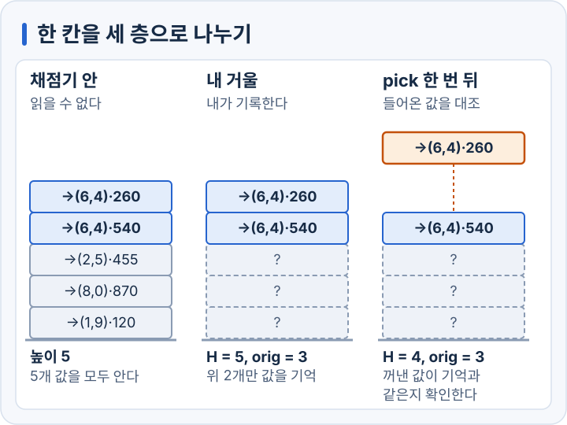
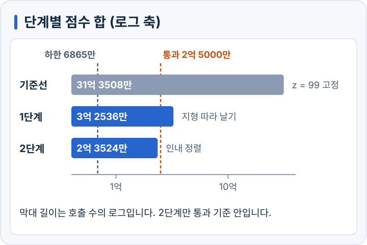

# 열어 본 상자를 기억해 쌓고 정렬하기

[드론 상자 정렬](/practice/DRONESORT)은 가로·세로·높이가 100인 창고에서 드론 한 대로 상자 100,000개를 각자의 목적지 칸으로 옮기는 문제입니다. 점수는 `move`·`pick`·`drop`을 부른 횟수이고 낮을수록 좋습니다. 이 문제에는 상자의 정보를 묻는 API가 없습니다. 목적지와 무게는 `pick`으로 상자를 **꺼낼 때만** 받고, 칸의 높이도 알려 주지 않습니다. 알아내는 일이 곧 움직이는 일이고, 한 번 꺼낸 상자의 값을 잊으면 같은 상자를 다시 꺼내야 합니다. 그래서 풀이는 (1) 꺼내서 알게 된 값과 높이를 **거울**에 기억하고, (2) 그 기억으로 날아다니는 높이와 상자를 쌓는 순서를 **계획**하는 두 일로 나뉩니다. 거울과 행동의 분리는 [채점기 상태를 따라 그리며 행동하기](https://h.readiz.com/learn/observe-and-act)와 같은 틀이지만, 여기서는 관측에 호출 비용이 들고 계획의 대상이 관측 순서가 아니라 **비행 고도와 정렬**이라는 점이 다릅니다.



[그림 크게 보기](https://git.readiz.com/h-contest-lesson/lessons/remember-and-sort/lesson-assets/state-layers.svg)

그림의 위 2개는 내가 직접 쌓은 상자입니다. 이 풀이는 상자를 항상 **목적지 칸 맨 위에** 쌓으므로 아직 열지 않은 칸 위의 상자는 모두 그 칸이 목적지입니다. 이 사실이 아래 풀이의 중심 불변식입니다. 이어지는 코드는 모두 h-contest 제출용이고 표준 헤더와 STL을 쓰지 않습니다. 큐·정렬·힙·난수 공통 블록은 필요 없고 고정 전역 배열만 씁니다.

## 문제 계약을 상태로 옮기기

| 항목 | 계약 |
| --- | --- |
| 호출 순서 | TC마다 `process()`가 한 번 호출됩니다. 시작할 때 드론은 `(99,99,99)`에서 상자를 들지 않았고 창고에는 상자 100,000개가 있습니다. 채점기는 TC마다 창고를 처음부터 다시 만듭니다. |
| 행동 API | `move(dir)`: `0..5`가 `x+1, x-1, y+1, y-1, z+1, z-1`. `pick(&destX,&destY,&weight)`: `z`가 칸 높이와 같을 때 맨 위 상자를 꺼내 목적지와 무게를 줍니다. `drop()`: `z`가 칸 높이보다 1 클 때 맨 위에 놓습니다. |
| 호출 비용 | 성공해도 실패해도 호출마다 1점입니다. 실패한 호출은 상태를 바꾸지 않습니다. |
| 이동 규칙 | 창고 밖으로는 못 갑니다. 상자 없이는 이동할 칸의 높이 `h`에 대해 `z ≥ h`, 상자를 들면 `z > h`여야 합니다. |
| 점수와 통과 | 10개 TC의 호출 수 합이며 낮을수록 좋습니다. 통과 기준은 250,000,000으로 TC당 평균 25,000,000, 상자당 평균 250번입니다. |
| 무효 조건 | 끝났을 때 상자가 목적지에 없거나, 같은 칸에서 위의 상자가 아래보다 무겁거나, 상자를 들고 있으면 그 TC는 10^13점이고 채점기는 거기서 멈춥니다. 칸 높이는 98까지만 허용되어 `drop`이 거절됩니다. |
| 상한 | 상자 100,000개, 한 칸 높이 최대 98, 전체 실행 시간 10초 |

초기 배치는 채점기가 상자마다 임의의 칸과 목적지 칸, 1~1000의 무게를 골라 만듭니다(채점 규칙을 읽어 확인한 내용이며 이 풀이는 생성기 값에 의존하지 않습니다). 상자가 10,000칸에 평균 10개씩 쌓이는 셈입니다. 내가 아는 것과 모르는 것은 세 층으로 나뉩니다.

| 층 | 내용 | 얻는 방법 |
| --- | --- | --- |
| 채점기가 아는 것 | 모든 상자의 위치·목적지·무게, 드론의 실제 위치와 점수 | 읽을 수 없음 |
| 내가 관측해 기억한 것 | 드론 위치와 `hold`(내 호출 결과로 갱신), 칸 높이 `H`, 열어 본 상자의 `bd`·`bw`, 열지 않은 원래 상자 수 `orig` | `move`·`pick`·`drop`의 반환값과 `pick`이 돌려준 값 |
| 아직 모르는 것 | 열지 않은 상자의 목적지와 무게, 높이를 재기 전의 칸 높이 | `pick`하거나 내려가 봐야 함 |

| 상태 | 언제 초기화하는가 | 이유 |
| --- | --- | --- |
| `px, py, pz, hold` | `measureHeights` 시작 | 채점기는 TC마다 드론을 `(99,99,99)`로 되돌립니다. 전역 초기값에 맡기면 첫 TC만 맞고 두 번째 TC부터 어긋납니다. |
| `H`, `orig`, `refused`, `mismatch` 등 | `process` 시작 | 새 창고입니다. `H`와 `orig`는 높이 재기가 다시 채웁니다. |
| `bd`, `bw` | 지우지 않음 | `H`와 `orig`로 걸러진 위치(이번 TC에서 내가 쌓은 상자)만 읽습니다. 쓰기 전에는 읽지 않으므로 4MB를 지울 이유가 없습니다. |

## 점수식 분해와 하한

호출은 네 가지입니다. 수평 이동, 수직 이동, `pick`, `drop`. 상자를 한 번 옮기는 데 `pick`과 `drop`이 최소 2번이고, 드론은 한 번에 상자 하나만 들 수 있으므로 상자를 든 수평 이동은 그 상자의 출발 칸과 목적지의 맨해튼 거리 이상입니다. 출발과 목적지가 무작위인 칸이면 거리의 기댓값은 약 66.7이므로 상자당 약 69번, 한 TC에 약 690만 번이 어떤 풀이든 넘어야 하는 하한입니다. 공개 채점기의 실제 입력에서 각 상자의 `거리 + 2`를 더한(이미 목적지에 있는 상자 제외) 10개 TC의 하한은 68,653,459이고 통과 기준은 그 약 3.6배입니다. 하한은 빈 손으로 돌아오는 이동과 높이 이동을 세지 않은 값입니다. 실제 풀이의 호출은 이 하한 위에 두 종류가 더 쌓입니다. 다음 상자를 가지러 돌아가는 **빈 손 이동**, 그리고 **수직 이동**입니다. 높이 100짜리 창고에서 항상 `z = 99`로 날면 칸 높이가 10이라도 `pick`마다 내려가고 올라가는 데 약 180번이 듭니다. 이 수직 이동이 어디서 줄어드는지가 아래 단계의 질문입니다.

## 세 구간으로 나눈 풀이

풀이는 한 TC를 세 구간으로 나눕니다. 구간 사이에서 거울만 믿습니다.

1. **높이 재기** (`measureHeights`): 칸을 뱀 모양으로 한 번 돌며 아래로 내려가 `move(5)`가 거절될 때의 `z`를 높이로 기록합니다. 막힌 칸은 한 칸 올라가 다시 시도합니다.
2. **비우기** (`clearCell`): 칸을 하나씩 비웁니다. 꺼낸 상자는 목적지 칸의 맨 위에 올립니다. 목적지 칸이 아직 열지 않은 칸이어도 상관없습니다. 올린 상자의 값은 거울에 남고, 그 칸을 비울 때 맨 위 `H - orig`개로 다시 나옵니다.
3. **정렬** (`sortCell`): 비우기가 끝나면 모든 칸에는 자기 목적지 상자만 순서 없이 쌓여 있습니다. 이제 칸마다 무게순으로 정렬합니다. 상자의 값은 전부 거울에 있어서 정렬 계획은 행동 없이 세울 수 있습니다.

비우기의 한 가지가 까다롭습니다. 칸 `c`를 비우려면 맨 위의 `H - orig`개(목적지가 `c`인 상자)부터 꺼내야 하는데, 꺼낸 상자를 `c`에 도로 놓을 수 없습니다. 그래서 옆 칸 `q`에 맡겼다가 `c`가 빈 뒤 돌려놓습니다. 맡기는 동안 `c`의 원래 상자 중 목적지가 `q`인 상자가 `q` 위에 도착하면 `q`의 맡긴 높이 `hb` 위가 섞입니다. 돌려놓을 때는 `hb` 위를 모두 꺼내 목적지가 `c`인 것만 `c`로 보내고, 나머지는 칸 `r`에 잠깐 두었다가 `q`로 되돌립니다. 이 경로는 상자 10개 중 하나가 특정 칸이 목적지일 확률이 약 0.1%라 공개 TC 10개에서 83번만 실행됩니다. 드물어서 큰 입력에서는 놓치기 쉽고, 아래 검사는 작은 창고에서 이 경로를 일부러 자주 만듭니다.

> **코드 환경: h-contest 제출용.** 아래 네 블록을 이 순서로 `user.cpp`에 붙입니다. 블록 이름 `drone-mirror`, `drone-clear`, `drone-sort`, `drone-entry`. 배열 상한은 `N = 100`이고, 칸 높이 98 이하·정렬할 상자 수 `k ≤ 98`이 인덱스 범위입니다. TC 초기화는 `process` 시작과 `measureHeights` 시작에 있습니다.

`drone-mirror`는 채점기 호출을 한 곳으로 모읍니다. `go`·`popTop`·`pushTop`이 거울을 갱신하는 유일한 통로이고, `goTo`가 거울의 높이로 날 높이를 정합니다. `TERRAIN`과 `CHOOSE_PATH`는 아래 단계별 비교를 위해 바꾸는 상수입니다.

```cpp snippet=drone-mirror
extern bool move(int dir);
extern bool pick(int& destX, int& destY, int& weight);
extern bool drop();

namespace dr {
const int N = 100;               // 창고 한 변 (x, y, z 모두)
const bool TERRAIN = true;       // false면 항상 z = N - 1 로만 날아다닌다
const bool CHOOSE_PATH = true;   // false면 항상 x 방향부터 이동한다
const int DX[6] = {1, -1, 0, 0, 0, 0};
const int DY[6] = {0, 0, 1, -1, 0, 0};

int px, py, pz;          // 거울: 드론 위치
bool hold;               // 거울: 상자를 들고 있는가
int H[N][N];             // 거울: 칸의 상자 높이
int orig[N][N];          // 바닥부터 아직 열어 보지 않은 상자 수
short bd[N][N][N];       // 열어 본 상자의 목적지 칸 번호 dy * N + dx
short bw[N][N][N];       // 열어 본 상자의 무게
int stage;               // 0 높이 재기, 1 비우기, 2 정렬 (로컬 검사가 읽는다)
int refused, mismatch;   // 거절된 호출 수, 거울과 다른 pick 결과 수
int deferred, fallbacks; // 비켜 둔 상자 수, 삽입 정렬로 물러난 칸 수 (로컬 검사용 계수)
int ox[N * N], oy[N * N];   // 칸을 도는 순서 (뱀 모양)

bool go(int dir) {       // 채점기 move 호출은 모두 여기를 지난다
    if (!move(dir)) return false;
    px += DX[dir]; py += DY[dir];
    if (dir == 4) ++pz; else if (dir == 5) --pz;
    return true;
}
void must(int dir) { if (!go(dir)) ++refused; }

int req(int x, int y) { return H[y][x] + (hold ? 1 : 0); }   // 이 칸에 들어갈 때 필요한 최소 z

void vz(int z) { while (pz < z) must(4); while (pz > z) must(5); }

// (tx, ty) 위 높이 tz로 간다. 지나는 칸의 높이는 거울로 안다.
void goTo(int tx, int ty, int tz) {
    if (px == tx && py == ty) { vz(tz); return; }
    int a = req(px, py), b = a;                                       // a: x 먼저, b: y 먼저
    for (int x = px; x != tx; ) { x += tx > px ? 1 : -1; if (req(x, py) > a) a = req(x, py); }
    for (int y = py; y != ty; ) { y += ty > py ? 1 : -1; if (req(tx, y) > a) a = req(tx, y); }
    for (int y = py; y != ty; ) { y += ty > py ? 1 : -1; if (req(px, y) > b) b = req(px, y); }
    for (int x = px; x != tx; ) { x += tx > px ? 1 : -1; if (req(x, ty) > b) b = req(x, ty); }
    bool xFirst = !CHOOSE_PATH || a <= b;
    vz(TERRAIN ? (xFirst ? a : b) : N - 1);
    if (xFirst) {
        while (px < tx) must(0); while (px > tx) must(1);
        while (py < ty) must(2); while (py > ty) must(3);
    } else {
        while (py < ty) must(2); while (py > ty) must(3);
        while (px < tx) must(0); while (px > tx) must(1);
    }
    vz(tz);
}

// 전제: 상자를 들지 않았고 pz == H[py][px] > 0. 열어 본 값을 거울에 남긴다.
void popTop(int& dx, int& dy, int& w) {
    if (!pick(dx, dy, w)) { ++refused; return; }
    hold = true;
    int h = --H[py][px];
    if (h < orig[py][px]) orig[py][px] = h;                           // 원래 상자를 처음 열었다
    else if (bd[py][px][h] != dy * N + dx || bw[py][px][h] != w) ++mismatch;   // 기억과 달랐다
}

// 전제: 상자를 들었고 pz == H[py][px] + 1
void pushTop(int dx, int dy, int w) {
    if (!drop()) { ++refused; return; }
    int h = H[py][px]++;
    bd[py][px][h] = dy * N + dx; bw[py][px][h] = w;
    hold = false;
}

// (sx, sy)의 맨 위 상자를 (tx, ty)의 맨 위로 옮긴다. 상자 내용은 pick 결과를 그대로 쓴다.
void shift(int sx, int sy, int tx, int ty) {
    goTo(sx, sy, H[sy][sx]);
    int dx, dy, w; popTop(dx, dy, w);
    goTo(tx, ty, H[ty][tx] + 1);
    pushTop(dx, dy, w);
}
}
```

`popTop`은 `pick`이 돌려준 값을 거울과 대조해 `mismatch`를 셉니다. 이 값은 정상이면 항상 0이고, 기억이 어긋난 코드는 첫 `pick`에서 0이 아니게 됩니다. `drone-clear`에는 높이 재기와 비우기가 있습니다.

```cpp snippet=drone-clear
namespace dr {
// 0단계: 모든 칸의 높이를 잰다. 내려가다 막히면 그 z가 높이다.
void measureHeights() {
    stage = 0;
    px = py = pz = N - 1; hold = false;                              // TC 시작 위치
    for (int i = 0; i < N * N; ++i) {
        if (i > 0) {
            int dir = ox[i] != ox[i - 1] ? (ox[i] > ox[i - 1] ? 0 : 1) : 3;
            while (!go(dir)) go(4);                                  // 높이를 모르니 막히면 한 칸 올라가 다시
        }
        while (go(5)) {}
        H[oy[i]][ox[i]] = pz; orig[oy[i]][ox[i]] = pz;
    }
}

// 칸 (cx, cy)의 상자를 모두 꺼내 각자의 목적지 맨 위로 보낸다.
// 목적지가 이 칸인 상자는 옆 칸 q에 맡겼다가 칸이 빈 뒤 돌려놓는다.
void clearCell(int cx, int cy) {
    if (H[cy][cx] == 0) return;
    int qx = cx > 0 ? cx - 1 : cx + 1, qy = cy;                      // 맡기는 칸
    int rx = qx, ry = qy > 0 ? qy - 1 : qy + 1;                      // 잠깐 비켜 둘 칸
    int hb = H[qy][qx];                                              // 맡기기 전 q의 높이
    while (H[cy][cx] > 0) {
        goTo(cx, cy, H[cy][cx]);
        int dx, dy, w; popTop(dx, dy, w);
        if (dx == cx && dy == cy) goTo(qx, qy, H[qy][qx] + 1);
        else goTo(dx, dy, H[dy][dx] + 1);
        pushTop(dx, dy, w);
    }
    int moved = 0;
    while (H[qy][qx] > hb) {                                         // q의 hb 위는 전부 거울이 아는 상자
        goTo(qx, qy, H[qy][qx]);
        int dx, dy, w; popTop(dx, dy, w);
        if (dx == cx && dy == cy) goTo(cx, cy, H[cy][cx] + 1);
        else { goTo(rx, ry, H[ry][rx] + 1); ++moved; }               // 맡기는 동안 q로 온 q의 상자
        pushTop(dx, dy, w);
    }
    deferred += moved;
    for (; moved > 0; --moved) shift(rx, ry, qx, qy);
}
}
```

`drone-sort`는 정렬 두 가지를 모두 담습니다. `PATIENCE`를 `false`로 두면 삽입 정렬만 씁니다.

```cpp snippet=drone-sort
namespace dr {
const bool PATIENCE = true;      // false면 삽입 정렬만 쓴다
const bool DIAGONAL = true;      // false면 위아래좌우 4칸만 임시 칸으로 쓴다

// 바닥에서 위로 무게가 줄어들지 않으면(같으면 허용) 이미 끝난 칸이다.
bool sorted(int cx, int cy) {
    for (int i = 1; i < H[cy][cx]; ++i) if (bw[cy][cx][i] > bw[cy][cx][i - 1]) return false;
    return true;
}

// 삽입 정렬: 위쪽을 s로 옮긴 뒤 하나씩 제자리에 끼운다. 옮기는 횟수는 역전 수에 비례한다.
void insertionSort(int cx, int cy) {
    int k = H[cy][cx], keep = 1;
    while (keep < k && bw[cy][cx][keep] <= bw[cy][cx][keep - 1]) ++keep;   // 바닥에서 이미 정렬된 부분
    int sx = cx > 0 ? cx - 1 : cx + 1, sy = cy;
    int tx = cx, ty = cy > 0 ? cy - 1 : cy + 1;
    for (int i = k - keep; i > 0; --i) shift(cx, cy, sx, sy);
    for (int i = k - keep; i > 0; --i) {
        int w = bw[sy][sx][H[sy][sx] - 1], j = 0;
        while (j < H[cy][cx] && bw[cy][cx][H[cy][cx] - 1 - j] < w) ++j;    // w보다 가벼워 비켜야 할 상자 수
        for (int t = 0; t < j; ++t) shift(cx, cy, tx, ty);
        shift(sx, sy, cx, cy);
        for (int t = 0; t < j; ++t) shift(tx, ty, cx, cy);
    }
}

// 인내 정렬 후 병합: 무게를 다 아니, 임시 칸마다 "위로 갈수록 무거운" 더미를 만들고
// 가장 무거운 윗면부터 골라 빈 칸에 쌓는다. 상자는 두 번만 움직인다.
bool patienceSort(int cx, int cy) {
    int k = H[cy][cx];
    int scx[8], scy[8], ns = 0;
    for (int dy = -1; dy <= 1; ++dy) for (int dx = -1; dx <= 1; ++dx) {
        int x = cx + dx, y = cy + dy;
        if ((dx || dy) && (DIAGONAL || !dx || !dy) && x >= 0 && x < N && y >= 0 && y < N) {
            scx[ns] = x; scy[ns] = y; ++ns;
        }
    }
    int top[8], onS[8], to[N];
    for (int j = 0; j < ns; ++j) top[j] = onS[j] = 0;
    for (int i = k - 1; i >= 0; --i) {                               // 계획만 세운다: 행동은 아직 없다
        int w = bw[cy][cx][i], best = -1;
        for (int j = 0; j < ns; ++j) if (top[j] <= w && (best < 0 || top[j] > top[best])) best = j;
        if (best < 0) return false;                                  // 임시 칸이 모자란다
        to[i] = best; top[best] = w; ++onS[best];
    }
    for (int i = k - 1; i >= 0; --i) shift(cx, cy, scx[to[i]], scy[to[i]]);
    for (int t = 0; t < k; ++t) {                                    // 가장 무거운 윗면부터 빈 칸에 쌓는다
        int best = -1, bt = -1;
        for (int j = 0; j < ns; ++j) {
            if (onS[j] == 0) continue;
            int w = bw[scy[j]][scx[j]][H[scy[j]][scx[j]] - 1];
            if (w > bt) { bt = w; best = j; }
        }
        shift(scx[best], scy[best], cx, cy); --onS[best];
    }
    return true;
}

void sortCell(int cx, int cy) {
    if (H[cy][cx] <= 1 || sorted(cx, cy)) return;
    if (PATIENCE && patienceSort(cx, cy)) return;
    if (PATIENCE) ++fallbacks;
    insertionSort(cx, cy);
}
}
```

`drone-entry`가 구간을 잇습니다.

```cpp snippet=drone-entry
void process() {
    using namespace dr;
    refused = mismatch = deferred = fallbacks = 0;
    for (int y = 0; y < N; ++y) for (int x = 0; x < N; ++x) H[y][x] = orig[y][x] = 0;
    for (int r = 0; r < N; ++r) for (int i = 0; i < N; ++i) {
        ox[r * N + i] = r % 2 == 0 ? N - 1 - i : i;                  // 드론이 있는 (99, 99)에서 시작
        oy[r * N + i] = N - 1 - r;
    }
    measureHeights();
    stage = 1;
    for (int i = 0; i < N * N; ++i) clearCell(ox[i], oy[i]);
    stage = 2;
    for (int i = 0; i < N * N; ++i) sortCell(ox[i], oy[i]);
}
```

## 기준선: 유효하지만 느린 풀이

`TERRAIN = false`, `CHOOSE_PATH = false`, `PATIENCE = false`로 두면 항상 `z = 99`에서 날고 삽입 정렬만 쓰는 기준선입니다. 모든 TC가 유효하고 `refused`·`mismatch`가 0이지만 점수는 통과 기준의 12배가 넘고, 이 컴퓨터에서 실행 시간도 채점기의 10초 제한을 넘습니다.

측정은 공개 채점기 `main.cpp`를 복사해 호출 종류와 구간별 호출 수를 세는 줄만 더한 로컬 사본에 위 코드를 붙여 했습니다. 측정일은 2026-11-19, 환경은 Apple M1 계열 arm64·macOS·Apple clang 17(`-std=c++17 -O2`)이고, 점수는 같은 입력에서 항상 같습니다. 시간은 10개 TC 전체를 세 번 실행한 시간(wall clock)의 중앙값입니다. 원본은 [measurements.json](lesson-assets/measurements.json)에 있습니다.

| 단계 | 바꾼 것 | 점수 합 | 통과 기준 대비 | 시간 s |
| --- | --- | --- | --- | --- |
| 기준선 | 항상 `z = 99`, 삽입 정렬 | 3,135,082,558 | 12.54배 | 15.09 |
| 1단계 | 거울의 높이로 고도 계획 (`TERRAIN`, `CHOOSE_PATH`) | 325,362,282 | 1.30배 | 2.03 |
| 2단계 | 무게를 아니 인내 정렬로 상자를 두 번만 옮기기 | 235,236,510 | 0.94배 | 1.45 |



[그림 크게 보기](https://git.readiz.com/h-contest-lesson/lessons/remember-and-sort/lesson-assets/stage-scores.svg)

2단계만 통과 기준 250,000,000 안이고 14,763,490번의 여유가 있습니다. 하한 68,653,459의 3.4배이므로 더 줄일 여지는 남아 있습니다. 구간별 호출은 다음과 같습니다(10개 TC 합).

| 단계 · 구간 | 수평 이동 | 수직 이동 | pick + drop | 합 |
| --- | --- | --- | --- | --- |
| 기준선 · 높이 재기 | 276,470 | 453,858 | 0 | 730,328 |
| 기준선 · 비우기 | 135,305,098 | 706,997,358 | 3,997,416 | 846,299,872 |
| 기준선 · 정렬 | 13,406,920 | 2,261,339,498 | 13,305,940 | 2,288,052,358 |
| 1단계 · 높이 재기 | 276,470 | 453,858 | 0 | 730,328 |
| 1단계 · 비우기 | 135,305,098 | 54,745,084 | 3,997,416 | 194,047,598 |
| 1단계 · 정렬 | 13,406,920 | 103,871,496 | 13,305,940 | 130,584,356 |
| 2단계 · 높이 재기 | 276,470 | 453,858 | 0 | 730,328 |
| 2단계 · 비우기 | 135,305,098 | 54,745,084 | 3,997,416 | 194,047,598 |
| 2단계 · 정렬 | 6,126,110 | 30,178,794 | 4,153,680 | 40,458,584 |

기준선의 호출은 거의 전부 수직 이동입니다. 1단계가 그것을 줄이면 이번에는 정렬 구간이 전체의 40%를 차지하고, 2단계가 이 정렬 구간을 줄입니다. 한 번에 하나씩 바꾸고 그다음 큰 쪽을 본 순서입니다.

## 1단계: 거울의 높이로 지형을 따라 날기

`goTo`는 두 가지 경로(x 먼저, y 먼저) 각각에 대해 지나는 칸의 필요 높이 `req`(`H`, 상자를 들면 `H + 1`)의 최댓값을 구하고, 작은 쪽 경로를 택해 그 높이까지만 올랐다가 내려갑니다. 높이를 모르면 안전하게 `z = 99`로 날 수밖에 없지만, 거울이 높이를 알면 필요한 만큼만 오릅니다. 이 단계는 고도 계획이라는 한 가지를 바꾸되 "필요한 높이까지만 오르기"(`TERRAIN`)와 "낮은 쪽 경로 고르기"(`CHOOSE_PATH`) 두 부분으로 구현하고, 뒤쪽 부분의 효과는 아래 실험에서 따로 잽니다. 손으로 따라가 봅니다. 4×2 일부의 칸 높이가 다음과 같고, `(0,0)`의 맨 위에서 방금 `pick`한 드론이 `z = 4`에서 상자를 든 채 `(3,1)`에 놓으려 합니다. `(0,0)`의 높이는 3으로 줄었고 `(3,1)`에 놓으려면 `z = 2`여야 합니다.

| y＼x | 0 | 1 | 2 | 3 |
| --- | --- | --- | --- | --- |
| 0 | 3 | 6 | 2 | 4 |
| 1 | 2 | 2 | 8 | 1 |

상자를 들었으니 `req = H + 1`입니다. x 먼저는 출발 칸 4, `(1,0)` 7, `(2,0)` 3, `(3,0)` 5, 도착 칸 `(3,1)` 2이므로 최댓값 `a = 7`입니다. y 먼저는 `(0,1)` 3, `(1,1)` 3, `(2,1)` 9, `(3,1)` 2이므로 `b = 9`입니다. `a ≤ b`라 x 먼저로 갑니다. `z = 4`에서 7까지 올라 3번, 오른쪽으로 3번, `y + 1`로 1번, `z = 2`까지 내려 5번이므로 **12번**입니다. 항상 `z = 99`로 나는 기준선은 95번 오르고 4번 가고 97번 내려가 **196번**입니다. 두 숫자는 `scripts/check_remember_and_sort.py`가 제출 코드를 그대로 돌려 호출 수로 다시 셉니다.

1단계는 점수를 9.6배 줄이지만 상자당 평균 호출이 아직 약 325번입니다.

## 2단계: 무게를 아니 정렬을 미리 계획한다

정렬 구간은 한 칸의 상자 10개 안팎에서 일어납니다. 삽입 정렬은 상자를 하나 끼울 때마다 가벼운 상자를 임시 칸에 비켰다가 되돌리므로 옮기는 횟수가 역전 수에 비례합니다. 상자의 무게는 이미 전부 거울에 있으니, 행동하기 전에 **어느 임시 칸에 어떤 순서로 둘지 계획**할 수 있습니다. 인내 정렬(patience sorting)은 꺼내는 순서대로 상자를 임시 칸 8개(주변 8칸)의 위에 올리되, 그 칸의 맨 위 무게가 상자보다 가벼우면(같으면 포함) 올립니다. 올릴 수 있는 칸이 여럿이면 맨 위가 가장 무거운 칸을 고르고, 없으면 계획이 실패해 삽입 정렬로 물러납니다. 계획이 서면 상자를 임시 칸으로 한 번, 다시 가장 무거운 윗면부터 골라 빈 칸으로 한 번 옮기므로 상자는 정확히 두 번만 움직입니다.

한 칸에 위로 갈수록 `4, 9, 2, 7, 7, 3, 8`(바닥이 4)이 쌓여 있다고 하겠습니다. 꺼내는 순서는 위에서부터 `8, 3, 7, 7, 2, 9, 4`입니다.

| 꺼낸 상자 | 바뀐 임시 칸 (바닥 → 위) | 고른 이유 |
| --- | --- | --- |
| 8 | ① 8 | 빈 칸 ① |
| 3 | ① 8, ② 3 | ①의 맨 위 8 > 3이라 못 올림, 빈 칸 ② |
| 7 | ② 3, 7 | ②의 3이 가장 무거운 후보(3 ≤ 7) |
| 7 | ② 3, 7, 7 | ②의 7 ≤ 7 |
| 2 | ③ 2 | ① 8, ② 7 모두 2보다 무거움, 빈 칸 ③ |
| 9 | ① 8, 9 | 후보 ① 8, ② 7, ③ 2 중 맨 위가 가장 무거운 ① |
| 4 | ③ 2, 4 | 4 이하인 맨 위는 ③ 2뿐 |

임시 칸은 ① `8,9`, ② `3,7,7`, ③ `2,4`가 되고 맨 위는 9, 7, 4입니다. 이제 가장 무거운 윗면부터 골라 빈 칸에 쌓으면 9(①), 8(①), 7(②), 7(②), 4(③), 3(②), 2(③) 순서로 바닥부터 `9, 8, 7, 7, 4, 3, 2`가 됩니다. 옮긴 횟수는 7 + 7 = **14번**입니다. 같은 칸을 삽입 정렬로 하면 **34번**입니다. 이 두 횟수와 임시 칸의 내용은 검사 스크립트가 제출 코드를 실행해 확인합니다.

임시 칸이 8칸이어야 하는 이유는 실험으로 봅니다.

## 실험: 경로 선택과 임시 칸 수

공개 채점기의 생성기 seed를 5(공개 값), 101, 202, 303, 404로 바꾼 입력 5개에서 두 선택을 하나씩 바꿨습니다. 알고리즘에는 난수가 없으므로 편차는 입력에서만 나옵니다. 표의 값은 10개 TC 점수 합입니다.

| 설정 | 중앙값 | 최솟값 | 최댓값 |
| --- | --- | --- | --- |
| 2단계 | 235,134,729 | 234,948,336 | 235,290,127 |
| x 먼저만 | 247,900,703 | 247,705,745 | 248,023,716 |
| 임시 칸 4개 | 293,033,959 | 292,404,640 | 293,318,573 |

두 변경 모두 입력을 바꾼 편차(최댓값과 최솟값의 차이 913,933 이하)보다 훨씬 큽니다. `CHOOSE_PATH`를 끄면(항상 x 먼저) 중앙값이 12,765,974(5.4%) 늘고, 임시 칸을 위아래좌우 4칸으로 줄이면 57,899,230(24.6%) 늘어납니다. 4칸이면 서로 다른 맨 위를 가진 더미가 4개뿐이라 인내 정렬 계획이 실패하는 칸이 늘어 삽입 정렬로 물러나기 때문입니다. 다만 이 입력들은 같은 생성기에서 seed만 바꾼 것이라 편차를 작게 보이게 할 수 있습니다. 그래서 2단계의 선택은 생성기와 다른 직접 만든 입력에서도 확인했습니다. 상자가 창고의 한쪽 구석 60×60 칸에만 쌓여 있고 칸당 평균 28개인 입력(채점기 생성기는 이런 입력을 만들지 않습니다)을 기준 시뮬레이터로 만들어 세 TC를 돌렸습니다.

| 단계 | TC 1 호출 | TC 2 호출 | TC 3 호출 |
| --- | --- | --- | --- |
| 1단계 (직접 만든 입력) | 32,117,465 | 32,124,244 | 32,053,996 |
| 2단계 (직접 만든 입력) | 23,108,049 | 23,158,612 | 23,089,054 |

세 TC 모두 2단계가 1단계보다 적습니다. 공개 TC 점수로 고른 설정이 아니라 입력 모양이 달라져도 순서가 유지된다는 뜻입니다. 비교 설계의 기준은 [실험 비교와 평가](https://h.readiz.com/learn/testing-and-stress/experiment-evaluation)를 따릅니다.

## 실패 사례를 재현하고 잡는다

기억과 실제 상태가 어긋나는 실수 네 가지를 한 줄씩 고쳐 공개 채점기로 돌렸습니다.

| 실수 | 공개 채점기 결과 | 로컬 검사에서 잡히는 곳 |
| --- | --- | --- |
| 높이 갱신 누락 | timeout: 20초 안에 끝나지 않음 | 첫 호출 직전의 높이 대조 |
| 맡긴 칸의 상자 가정 | TC 1에서 10,000,000,000,000점 | 최종 상태 검증 |
| TC 시작 위치 초기화 누락 | TC 2에서 10,000,000,000,000점 (TC 1은 23,475,573) | TC 2 첫 호출 직전의 위치 대조 |
| 병합에서 가벼운 윗면 먼저 | TC 1에서 10,000,000,000,000점 | 최종 상태 검증 |

- **높이 갱신 누락**: `pushTop`이 `H`를 올리지 않으면 거울의 높이가 실제보다 낮아지고 이후 호출이 거절되며 코드가 끝나지 않습니다. 실패한 호출도 1점씩 쌓이므로 점수로는 보이지 않고 채점기에서는 시간 초과입니다. 로컬 검사는 첫 호출 직전의 높이 불일치로 바로 잡습니다.
- **맡긴 칸의 상자 가정**: `q`의 `hb` 위가 전부 목적지 `c`라고 믿으면 목적지가 `q`인 상자(TC당 평균 8번쯤)가 `c`에 남습니다. 거울과 호출 수는 정상이고 최종 상태만 틀리므로 유효성 검증으로만 드러납니다.
- **TC 시작 위치 초기화 누락**: 위치를 전역 초기값(99)에 맡기면 TC 1은 맞고 TC 2부터 거울의 드론이 실제 드론과 다릅니다. TC 1 점수는 정상이라 TC 한 개짜리 시험으로는 보이지 않습니다.
- **병합에서 가벼운 윗면 먼저**: 정렬 방향이 반대면 호출 수는 비슷하고 칸이 거꾸로 정렬됩니다. 이것도 최종 검증에서만 잡힙니다.

`scripts/check_remember_and_sort.py`는 공개 채점기가 없어도 문제 규칙을 따로 구현한 **기준 시뮬레이터**로 같은 일을 합니다. 시뮬레이터는 매 호출 직전 거울의 드론 위치와 `hold`, 드론 아래 칸의 높이와 열어 본 상자 값을 실제와 대조하고 997번째 호출마다 창고 전체를 대조합니다. 창고 크기 12~30, 칸당 상자 1~4개의 무작위 입력 54개 TC(연속 TC 포함)와 모든 단계 설정에서 거울이 어긋난 적이 없고 거절된 호출이 0이며 최종 상태가 유효합니다. 이 중 맡기는 동안 `q` 목적지 상자가 도착한 경우를 160번, 인내 정렬이 실패해 삽입 정렬로 물러난 경우를 25번 거쳤습니다. 네 가지 실패 변형은 모두 거울 불일치, 호출 한도 초과, 무효한 최종 상태 중 하나로 잡힙니다. `TC 시작 위치 초기화 누락`은 TC 1만 돌리면 유효하다는 것도 따로 확인합니다. 숫자 표는 JSON과 일치하는지, 손계산 숫자(14·34·12·196번)는 제출 코드의 실제 호출로 다시 세어 대조합니다. 검사는 ASan/UBSan으로 실행하고, 공개 채점기가 있으면 `--judge main.cpp`로 같은 점수를 다시 잽니다.

## 연습: DRONESORT

[드론 상자 정렬](/practice/DRONESORT)에서 다음을 수행합니다.

1. 위 네 블록을 그대로 제출해 모든 TC가 유효한지 봅니다. 상수 세 개를 기준선 값으로 바꿔 제출하면 표의 3,135,082,558과 맞아야 합니다.
2. `TERRAIN`과 `CHOOSE_PATH`를 켜면 325,362,282, `PATIENCE`까지 켜면 235,236,510이 되는지 확인합니다. 점수와 함께 `refused`·`mismatch`를 로컬 하네스에서 확인하고 둘 다 0이어야 합니다.
3. 다음 개선을 직접 설계합니다. 2단계 점수 235,236,510의 약 58%는 비우기의 수평 이동입니다. 상자 하나를 목적지에 보내고 같은 칸으로 돌아오는 왕복을 줄이려면 다음 상자를 가까운 칸에서 가져와야 하고, 그러면 목적지에 쌓은 상자가 아직 열지 않은 상자를 덮는 문제를 어떻게 관리할지가 과제입니다. 바꾼 뒤에는 같은 검사로 거울이 맞는지, 점수 합이 줄었는지 확인합니다.

[채점기 상태를 따라 그리며 행동하기](https://h.readiz.com/learn/observe-and-act)의 `mine::Mirror`는 점수까지 거울로 계산해 채점기와 대조했습니다. 이 문제에는 점수를 대조할 값이 호출 수뿐이라, 거울의 높이와 열어 본 상자 값을 직접 실제 상태와 대조하는 검사가 같은 역할을 합니다. 두 강의 모두 행동 호출을 한 곳으로 모으고 TC 시작 초기화를 먼저 확인한다는 점이 같습니다.
