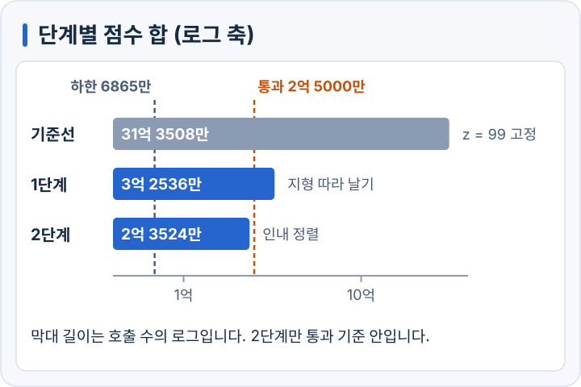
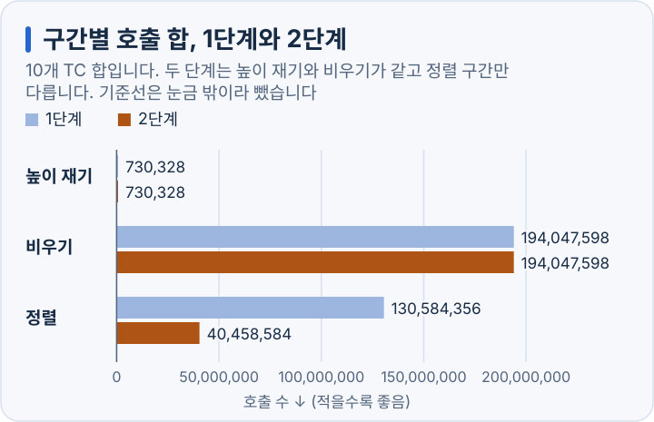
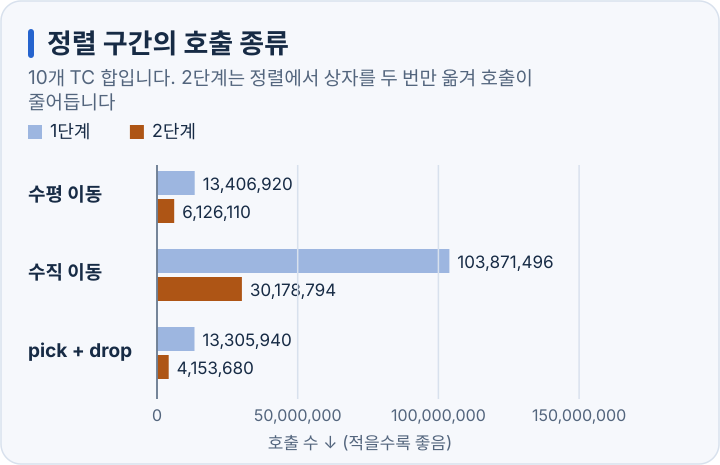
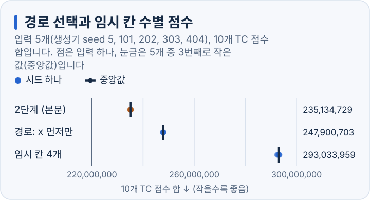

# 열어 본 상자를 기억해 쌓고 정렬하기: 실측과 실패 사례

같은 코드에서 상수를 꺼 만든 기준선과 1·2단계의 호출 수, 경로 선택과 임시 칸 수 실험, 거울이 어긋나는 실수의 재현을 다룹니다. 코드는 [풀이](solution.md)에 있습니다.

## 기준선: 유효하지만 느린 풀이

`TERRAIN = false`, `CHOOSE_PATH = false`, `PATIENCE = false`로 두면 항상 `z = 99`에서 날고 삽입 정렬만 쓰는 기준선입니다. 모든 TC가 유효하고 `refused`·`mismatch`가 0이지만 점수는 통과 기준의 12배가 넘고, 이 컴퓨터에서 실행 시간도 채점기의 10초 제한을 넘습니다.

측정은 공개 채점기 `main.cpp`를 복사해 호출 종류와 구간별 호출 수를 세는 줄만 더한 로컬 사본에 [위 코드](solution.md)를 붙여 했습니다. 측정일은 2026-11-19, 환경은 Apple M1 계열 arm64·macOS·Apple clang 17(`-std=c++17 -O2`)이고, 점수는 같은 입력에서 항상 같습니다. 시간은 10개 TC 전체를 세 번 실행한 시간(wall clock)의 중앙값입니다. 원본은 [measurements.json](https://git.readiz.com/h-contest-lesson/lessons/remember-and-sort/lesson-assets/measurements.json)에 있습니다.

| 단계 | 바꾼 것 | 점수 합 | 통과 기준 대비 | 시간 s |
| --- | --- | --- | --- | --- |
| 기준선 | 항상 `z = 99`, 삽입 정렬 | 3,135,082,558 | 12.54배 | 15.09 |
| 1단계 | 거울의 높이로 고도 계획 (`TERRAIN`, `CHOOSE_PATH`) | 325,362,282 | 1.30배 | 2.03 |
| 2단계 | 무게를 아니 인내 정렬로 상자를 두 번만 옮기기 | 235,236,510 | 0.94배 | 1.45 |

[그림 크게 보기](https://git.readiz.com/h-contest-lesson/lessons/remember-and-sort/lesson-assets/stage-scores.svg)

2단계만 통과 기준 250,000,000 안이고 14,763,490번의 여유가 있습니다. 하한 68,653,459의 3.4배이므로 더 줄일 여지는 남아 있습니다. 구간별 호출은 다음과 같습니다(10개 TC 합).

| 단계 · 구간 | 수평 이동 | 수직 이동 | pick + drop | 합 |
| --- | --- | --- | --- | --- |
| 기준선 · 높이 재기 | 276,470 | 453,858 | 0 | 730,328 |
| 기준선 · 비우기 | 135,305,098 | 706,997,358 | 3,997,416 | 846,299,872 |
| 기준선 · 정렬 | 13,406,920 | 2,261,339,498 | 13,305,940 | 2,288,052,358 |
| 1단계 · 높이 재기 | 276,470 | 453,858 | 0 | 730,328 |
| 1단계 · 비우기 | 135,305,098 | 54,745,084 | 3,997,416 | 194,047,598 |
| 1단계 · 정렬 | 13,406,920 | 103,871,496 | 13,305,940 | 130,584,356 |
| 2단계 · 높이 재기 | 276,470 | 453,858 | 0 | 730,328 |
| 2단계 · 비우기 | 135,305,098 | 54,745,084 | 3,997,416 | 194,047,598 |
| 2단계 · 정렬 | 6,126,110 | 30,178,794 | 4,153,680 | 40,458,584 |

[그림 크게 보기](https://git.readiz.com/h-contest-lesson/lessons/remember-and-sort/lesson-assets/phase-calls.svg)

기준선의 호출은 거의 전부 수직 이동입니다. 1단계가 그것을 줄이면 이번에는 정렬 구간이 전체의 40%를 차지하고, 2단계가 이 정렬 구간을 줄입니다. 한 번에 하나씩 바꾸고 그다음 큰 쪽을 본 순서입니다.

[그림 크게 보기](https://git.readiz.com/h-contest-lesson/lessons/remember-and-sort/lesson-assets/sort-calls.svg)

## 1단계: 거울의 높이로 지형을 따라 날기

`goTo`는 두 가지 경로(x 먼저, y 먼저) 각각에 대해 지나는 칸의 필요 높이 `req`(`H`, 상자를 들면 `H + 1`)의 최댓값을 구하고, 작은 쪽 경로를 택해 그 높이까지만 올랐다가 내려갑니다. 높이를 모르면 안전하게 `z = 99`로 날 수밖에 없지만, 거울이 높이를 알면 필요한 만큼만 오릅니다. 이 단계는 고도 계획이라는 한 가지를 바꾸되 "필요한 높이까지만 오르기"(`TERRAIN`)와 "낮은 쪽 경로 고르기"(`CHOOSE_PATH`) 두 부분으로 구현하고, 뒤쪽 부분의 효과는 아래 실험에서 따로 잽니다. 손으로 따라가 봅니다. 4×2 일부의 칸 높이가 다음과 같고, `(0,0)`의 맨 위에서 방금 `pick`한 드론이 `z = 4`에서 상자를 든 채 `(3,1)`에 놓으려 합니다. `(0,0)`의 높이는 3으로 줄었고 `(3,1)`에 놓으려면 `z = 2`여야 합니다.

| y＼x | 0 | 1 | 2 | 3 |
| --- | --- | --- | --- | --- |
| 0 | 3 | 6 | 2 | 4 |
| 1 | 2 | 2 | 8 | 1 |

상자를 들었으니 `req = H + 1`입니다. x 먼저는 출발 칸 4, `(1,0)` 7, `(2,0)` 3, `(3,0)` 5, 도착 칸 `(3,1)` 2이므로 최댓값 `a = 7`입니다. y 먼저는 `(0,1)` 3, `(1,1)` 3, `(2,1)` 9, `(3,1)` 2이므로 `b = 9`입니다. `a ≤ b`라 x 먼저로 갑니다. `z = 4`에서 7까지 올라 3번, 오른쪽으로 3번, `y + 1`로 1번, `z = 2`까지 내려 5번이므로 **12번**입니다. 항상 `z = 99`로 나는 기준선은 95번 오르고 4번 가고 97번 내려가 **196번**입니다. 두 숫자는 `scripts/check_remember_and_sort.py`가 제출 코드를 그대로 돌려 호출 수로 다시 셉니다.

1단계는 점수를 9.6배 줄이지만 상자당 평균 호출이 아직 약 325번입니다.

## 2단계: 무게를 아니 정렬을 미리 계획한다

정렬 구간은 한 칸의 상자 10개 안팎에서 일어납니다. 삽입 정렬은 상자를 하나 끼울 때마다 가벼운 상자를 임시 칸에 비켰다가 되돌리므로 옮기는 횟수가 역전 수에 비례합니다. 상자의 무게는 이미 전부 거울에 있으니, 행동하기 전에 **어느 임시 칸에 어떤 순서로 둘지 계획**할 수 있습니다. 인내 정렬(patience sorting)은 꺼내는 순서대로 상자를 임시 칸 8개(주변 8칸)의 위에 올리되, 그 칸의 맨 위 무게가 상자보다 가벼우면(같으면 포함) 올립니다. 올릴 수 있는 칸이 여럿이면 맨 위가 가장 무거운 칸을 고르고, 없으면 계획이 실패해 삽입 정렬로 물러납니다. 계획이 서면 상자를 임시 칸으로 한 번, 다시 가장 무거운 윗면부터 골라 빈 칸으로 한 번 옮기므로 상자는 정확히 두 번만 움직입니다.

한 칸에 위로 갈수록 `4, 9, 2, 7, 7, 3, 8`(바닥이 4)이 쌓여 있다고 하겠습니다. 꺼내는 순서는 위에서부터 `8, 3, 7, 7, 2, 9, 4`입니다.

| 꺼낸 상자 | 바뀐 임시 칸 (바닥 → 위) | 고른 이유 |
| --- | --- | --- |
| 8 | ① 8 | 빈 칸 ① |
| 3 | ① 8, ② 3 | ①의 맨 위 8 > 3이라 못 올림, 빈 칸 ② |
| 7 | ② 3, 7 | ②의 3이 가장 무거운 후보(3 ≤ 7) |
| 7 | ② 3, 7, 7 | ②의 7 ≤ 7 |
| 2 | ③ 2 | ① 8, ② 7 모두 2보다 무거움, 빈 칸 ③ |
| 9 | ① 8, 9 | 후보 ① 8, ② 7, ③ 2 중 맨 위가 가장 무거운 ① |
| 4 | ③ 2, 4 | 4 이하인 맨 위는 ③ 2뿐 |

임시 칸은 ① `8,9`, ② `3,7,7`, ③ `2,4`가 되고 맨 위는 9, 7, 4입니다. 이제 가장 무거운 윗면부터 골라 빈 칸에 쌓으면 9(①), 8(①), 7(②), 7(②), 4(③), 3(②), 2(③) 순서로 바닥부터 `9, 8, 7, 7, 4, 3, 2`가 됩니다. 옮긴 횟수는 7 + 7 = **14번**입니다. 같은 칸을 삽입 정렬로 하면 **34번**입니다. 이 두 횟수와 임시 칸의 내용은 검사 스크립트가 제출 코드를 실행해 확인합니다.

임시 칸이 8칸이어야 하는 이유는 실험으로 봅니다.

## 실험: 경로 선택과 임시 칸 수

공개 채점기의 생성기 seed를 5(공개 값), 101, 202, 303, 404로 바꾼 입력 5개에서 두 선택을 하나씩 바꿨습니다. 알고리즘에는 난수가 없으므로 편차는 입력에서만 나옵니다. 표의 값은 10개 TC 점수 합입니다.

| 설정 | 중앙값 | 최솟값 | 최댓값 |
| --- | --- | --- | --- |
| 2단계 | 235,134,729 | 234,948,336 | 235,290,127 |
| x 먼저만 | 247,900,703 | 247,705,745 | 248,023,716 |
| 임시 칸 4개 | 293,033,959 | 292,404,640 | 293,318,573 |

[그림 크게 보기](https://git.readiz.com/h-contest-lesson/lessons/remember-and-sort/lesson-assets/choice-seeds.svg)

두 변경 모두 입력을 바꾼 편차(최댓값과 최솟값의 차이 913,933 이하)보다 훨씬 큽니다. `CHOOSE_PATH`를 끄면(항상 x 먼저) 중앙값이 12,765,974(5.4%) 늘고, 임시 칸을 위아래좌우 4칸으로 줄이면 57,899,230(24.6%) 늘어납니다. 4칸이면 서로 다른 맨 위를 가진 더미가 4개뿐이라 인내 정렬 계획이 실패하는 칸이 늘어 삽입 정렬로 물러나기 때문입니다. 다만 이 입력들은 같은 생성기에서 seed만 바꾼 것이라 편차를 작게 보이게 할 수 있습니다. 그래서 2단계의 선택은 생성기와 다른 직접 만든 입력에서도 확인했습니다. 상자가 창고의 한쪽 구석 60×60 칸에만 쌓여 있고 칸당 평균 28개인 입력(채점기 생성기는 이런 입력을 만들지 않습니다)을 기준 시뮬레이터로 만들어 세 TC를 돌렸습니다.

| 단계 | TC 1 호출 | TC 2 호출 | TC 3 호출 |
| --- | --- | --- | --- |
| 1단계 (직접 만든 입력) | 32,117,465 | 32,124,244 | 32,053,996 |
| 2단계 (직접 만든 입력) | 23,108,049 | 23,158,612 | 23,089,054 |

세 TC 모두 2단계가 1단계보다 적습니다. 공개 TC 점수로 고른 설정이 아니라 입력 모양이 달라져도 순서가 유지된다는 뜻입니다. 비교 설계의 기준은 [실험과 튜닝](https://h.readiz.com/learn/experiments-and-tuning)를 따릅니다.

## 실패 사례를 재현하고 잡는다

기억과 실제 상태가 어긋나는 실수 네 가지를 한 줄씩 고쳐 공개 채점기로 돌렸습니다.

| 실수 | 공개 채점기 결과 | 로컬 검사에서 잡히는 곳 |
| --- | --- | --- |
| 높이 갱신 누락 | timeout: 20초 안에 끝나지 않음 | 첫 호출 직전의 높이 대조 |
| 맡긴 칸의 상자 가정 | TC 1에서 10,000,000,000,000점 | 최종 상태 검증 |
| TC 시작 위치 초기화 누락 | TC 2에서 10,000,000,000,000점 (TC 1은 23,475,573) | TC 2 첫 호출 직전의 위치 대조 |
| 병합에서 가벼운 윗면 먼저 | TC 1에서 10,000,000,000,000점 | 최종 상태 검증 |

- **높이 갱신 누락**: `pushTop`이 `H`를 올리지 않으면 거울의 높이가 실제보다 낮아지고 이후 호출이 거절되며 코드가 끝나지 않습니다. 실패한 호출도 1점씩 쌓이므로 점수로는 보이지 않고 채점기에서는 시간 초과입니다. 로컬 검사는 첫 호출 직전의 높이 불일치로 바로 잡습니다.
- **맡긴 칸의 상자 가정**: `q`의 `hb` 위가 전부 목적지 `c`라고 믿으면 목적지가 `q`인 상자(TC당 평균 8번쯤)가 `c`에 남습니다. 거울과 호출 수는 정상이고 최종 상태만 틀리므로 유효성 검증으로만 드러납니다.
- **TC 시작 위치 초기화 누락**: 위치를 전역 초기값(99)에 맡기면 TC 1은 맞고 TC 2부터 거울의 드론이 실제 드론과 다릅니다. TC 1 점수는 정상이라 TC 한 개짜리 시험으로는 보이지 않습니다.
- **병합에서 가벼운 윗면 먼저**: 정렬 방향이 반대면 호출 수는 비슷하고 칸이 거꾸로 정렬됩니다. 이것도 최종 검증에서만 잡힙니다.

`scripts/check_remember_and_sort.py`는 공개 채점기가 없어도 문제 규칙을 따로 구현한 **기준 시뮬레이터**로 같은 일을 합니다. 시뮬레이터는 매 호출 직전 거울의 드론 위치와 `hold`, 드론 아래 칸의 높이와 열어 본 상자 값을 실제와 대조하고 997번째 호출마다 창고 전체를 대조합니다. 창고 크기 12~30, 칸당 상자 1~4개의 무작위 입력 54개 TC(연속 TC 포함)와 모든 단계 설정에서 거울이 어긋난 적이 없고 거절된 호출이 0이며 최종 상태가 유효합니다. 이 중 맡기는 동안 `q` 목적지 상자가 도착한 경우를 160번, 인내 정렬이 실패해 삽입 정렬로 물러난 경우를 25번 거쳤습니다. 네 가지 실패 변형은 모두 거울 불일치, 호출 한도 초과, 무효한 최종 상태 중 하나로 잡힙니다. `TC 시작 위치 초기화 누락`은 TC 1만 돌리면 유효하다는 것도 따로 확인합니다. 숫자 표는 JSON과 일치하는지, 손계산 숫자(14·34·12·196번)는 제출 코드의 실제 호출로 다시 세어 대조합니다. 검사는 ASan/UBSan으로 실행하고, 공개 채점기가 있으면 `--judge main.cpp`로 같은 점수를 다시 잽니다.
