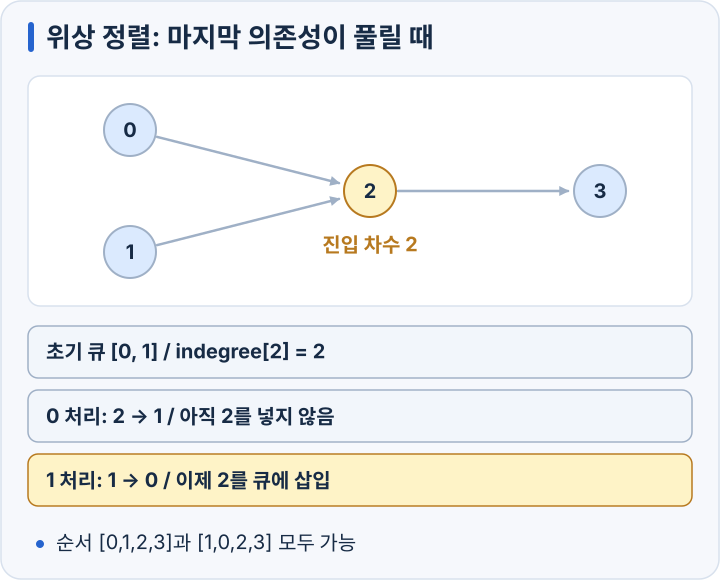
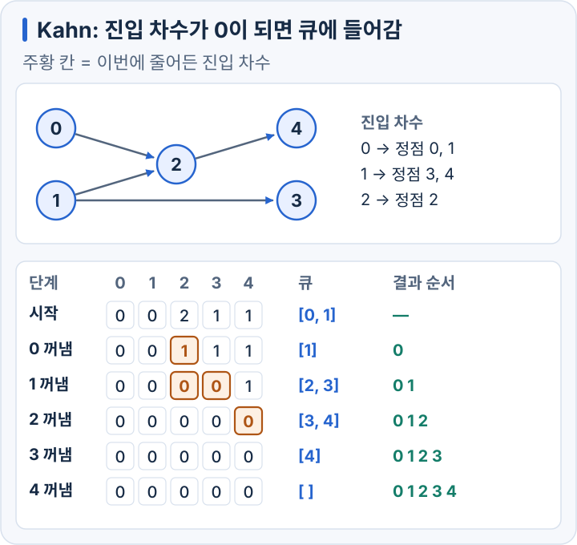

# 위상 정렬과 DAG DP

위상 정렬은 방향 그래프에서 모든 간선의 방향을 지키도록 정점을 나열하는 방법입니다.

```text
A를 끝내야 B를 할 수 있다.
B를 끝내야 C를 할 수 있다.
```

이런 의존 관계가 있으면 가능한 작업 순서를 찾아야 합니다. 그래프에 사이클이 있으면 모든 의존 관계를 만족하는 순서는 존재하지 않습니다.

위상 정렬은 DAG에서만 가능합니다. DAG는 Directed Acyclic Graph, 즉 사이클이 없는 방향 그래프입니다.

## 방향 그래프와 의존 관계

간선 `u -> v`를 "u가 먼저 와야 v를 할 수 있다"라고 해석하겠습니다.

```text
0 -> 2
1 -> 2
2 -> 3
```

가능한 위상 순서 중 하나는 아래와 같습니다.

```text
0, 1, 2, 3
```

`1, 0, 2, 3`도 가능합니다. 위상 정렬 결과는 하나로 고정되지 않을 수 있습니다. 중요한 것은 모든 간선 `u -> v`에 대해 `u`가 `v`보다 앞에 있어야 한다는 조건입니다.

## 진입 차수



[그림 크게 보기](https://git.readiz.com/h-contest-lesson/lessons/topological-sort-dag/lesson-assets/structure-trace.svg)

0만 처리한 시점에는 1의 의존성이 남아 있습니다. 들어오는 간선 수가 정확히 0이 되었을 때만 2를 처리 후보로 넣습니다.

진입 차수는 어떤 정점으로 들어오는 간선의 수입니다.

```text
indegree[v] = v로 들어오는 간선 수 (중복 간선도 각각 센다)
```

진입 차수가 0인 정점은 지금 바로 처리할 수 있습니다. 위상 정렬의 가장 대표적인 알고리즘인 Kahn 알고리즘은 이 성질을 사용합니다.

```text
1. indegree가 0인 정점을 큐에 넣는다.
2. 큐에서 하나를 꺼내 결과 순서에 넣는다.
3. 그 정점에서 나가는 간선을 제거한다고 생각하며 다음 정점의 indegree를 줄인다.
4. 새로 indegree가 0이 된 정점을 큐에 넣는다.
```



[그림 크게 보기](https://git.readiz.com/h-contest-lesson/lessons/topological-sort-dag/lesson-assets/kahn-trace.svg)

로컬 연습의 예시 그래프입니다. 정점 2는 0을 꺼낸 뒤에도 진입 차수가 1이라 큐에 들어가지 못하고, 1까지 꺼낸 뒤에야 0이 됩니다.

## Kahn 알고리즘

아래는 0-indexed 정점 `0`부터 `n - 1`까지를 다루는 구현입니다.

> **코드 환경: h-contest 제출용 코드.** [공통 코드](https://h.readiz.com/learn/cpp-common-library)의 `queue` 블록을 먼저 붙입니다. 표준 헤더·STL·동적 할당 없이 고정 배열로 구현하며, 아래 코드 블록을 순서대로 이어서 사용합니다.

그래프는 [BFS/DFS 강의](https://h.readiz.com/learn/bfs-dfs-grid)와 같은 head/next 배열 인접 리스트입니다. 상한 `MAX_V = 200000`, `MAX_E = 400000`은 이 강의 연습의 입력 상한과 같은 값이며, 실제 문제에서는 제한에 맞춰 바꿉니다. 큰 `Graph`와 배열은 전역으로 두고 TC마다 `graph.init(n)`을 호출합니다. `indegree`는 함수가 `[0, n)`을 0으로 채우므로 이전 TC의 값이 남지 않습니다.

```cpp
const int MAX_V = 200000; // 정점 수 상한
const int MAX_E = 400000; // 방향 간선 수 상한

struct Graph {
    int head[MAX_V];
    int next[MAX_E];
    int to[MAX_E];
    int edgeCount;

    void init(int n) { // 전제: 0 <= n <= MAX_V
        for (int i = 0; i < n; ++i) head[i] = -1;
        edgeCount = 0;
    }
    bool addEdge(int u, int v) { // 간선이 가득 차면 false
        if (edgeCount == MAX_E) return false;
        to[edgeCount] = v;
        next[edgeCount] = head[u];
        head[u] = edgeCount++;
        return true;
    }
};
```

정점은 `indegree`가 0이 되는 순간 한 번만 큐에 들어가므로 누적 push는 `n <= MAX_V`이고 `hc::Queue<MAX_V>`면 충분합니다. 함수는 위상 순서를 `order[0..count)`에 쓰고 `count`를 반환합니다. `n`이 `0..MAX_V` 밖이면 -1입니다. `order`는 `n`칸 이상 준비합니다.

```cpp
int indegree[MAX_V];
hc::Queue<MAX_V> readyQueue;

int topologicalSort(const Graph& graph, int n, int order[]) {
    if (n < 0 || n > MAX_V) return -1;
    for (int i = 0; i < n; ++i) indegree[i] = 0;

    for (int u = 0; u < n; ++u) {
        for (int e = graph.head[u]; e != -1; e = graph.next[e]) {
            indegree[graph.to[e]]++;
        }
    }

    readyQueue.clear();
    for (int i = 0; i < n; ++i) {
        if (indegree[i] == 0) readyQueue.push(i);
    }

    int count = 0;
    int u;
    while (readyQueue.pop(u)) {
        order[count++] = u;

        for (int e = graph.head[u]; e != -1; e = graph.next[e]) {
            int v = graph.to[e];
            indegree[v]--;
            if (indegree[v] == 0) {
                readyQueue.push(v);
            }
        }
    }

    return count;
}
```

반환값 `count`가 `n`이면 위상 정렬에 성공한 것입니다.

## 사이클 판정

방향 그래프에 사이클이 있으면 모든 정점을 처리할 수 없습니다. 큐가 비었는데 아직 indegree가 남은 정점들이 생깁니다.

예를 들어 아래 그래프는 순서를 만들 수 없습니다.

```text
0 -> 1
1 -> 2
2 -> 0
```

어떤 정점을 먼저 하려고 해도 다른 정점을 먼저 해야 한다는 조건에 걸립니다.

위상 정렬 문제에서 `count != n` 검사는 거의 필수입니다. 입력이 DAG라고 보장되지 않으면 반드시 확인합니다.

## 순서가 여러 개일 때

사전순으로 가장 작은 순서를 요구하면 큐를 최소 힙으로 바꾸어, 현재 진입 차수가 0인 정점 중 번호가 가장 작은 것을 꺼냅니다. 초기 정점만 정렬해서 큐에 넣는 것으로는 부족합니다. 탐색 중 새로 들어온 더 작은 번호도 다음 선택에 반영해야 하기 때문입니다.

## 작업 완료 시간

각 작업에 걸리는 시간이 있고, 모든 선행 작업이 끝나야 시작할 수 있습니다. 동시에 실행할 수 있는 작업 수에는 제한이 없다고 가정합니다. 위상 순서로 처리하면 선행 작업의 완료 시간이 모두 계산된 뒤 현재 작업을 계산할 수 있습니다. 아래 코드는 사이클이 있으면 `false`를 반환하고, 완료 시간은 `long long`으로 누적합니다.

```cpp
int topoOrder[MAX_V];

// 사이클이 있거나 n이 범위 밖이면 false. 성공하면 finish[0..n)를 채운다.
bool earliestFinish(const Graph& graph, int n, const int duration[], long long finish[]) {
    int count = topologicalSort(graph, n, topoOrder);
    if (count != n) return false;
    for (int i = 0; i < n; ++i) finish[i] = 0;

    for (int i = 0; i < n; ++i) {
        int u = topoOrder[i];
        finish[u] += duration[u];

        for (int e = graph.head[u]; e != -1; e = graph.next[e]) {
            int v = graph.to[e];
            if (finish[u] > finish[v]) finish[v] = finish[u];
        }
    }
    return true;
}
```

`finish[v]`는 `v`가 시작하기 전까지 끝나야 하는 선행 작업들의 완료 시간 최댓값을 먼저 모읍니다. 위상 순서대로 처리하므로 선행 작업 정보가 모두 반영된 뒤 `v`가 처리됩니다.

앞의 `0→2`, `1→2`, `2→3`에서 작업 시간이 각각 `2, 5, 3, 4`라면 완료 시간은 `2, 5, 8, 12`입니다. 작업 2는 두 선행 작업의 시간 **합** 7이 아니라 마지막으로 끝나는 시각 5부터 시작합니다.

위상 순서를 쓰는 이유는 다른 DAG DP도 같습니다. 경로 수라면 선행 경로 수를 더하고, 최단거리라면 `dist[u] + cost`의 최솟값을 전달합니다. 최단거리에서 도달 불가 상태는 `INF`로 두고 전이하지 않습니다. 사이클이 없어 음수 간선도 처리할 수 있습니다.

## 시간 복잡도

진입 차수 계산, 큐를 쓴 위상 정렬, 위의 작업 시간 DP는 각각 `O(V + E)`입니다. 최소 힙을 쓰면 정점별 삽입·삭제 비용이 붙어 `O(E + V log V)`입니다. 인접 목록과 보조 배열의 메모리는 `O(V + E)`입니다.

## 로컬 연습: 사전순으로 가장 작은 위상 순서

작업 의존 그래프에서 가능한 위상 순서 중 정점 번호의 사전순으로 가장 작은 순서를 구하세요.

**입력:** N M 뒤 M줄의 u v이며 u를 v보다 먼저 수행해야 합니다. 1 <= N <= 200000, 0 <= M <= 400000, 정점은 0-based입니다.

**출력:** 순서가 존재하면 N개 정점, cycle이 있으면 CYCLE을 출력합니다.

### 예시

```text exercise=topological-sort-dag role=input
5 4
0 2
1 2
1 3
2 4
```

```text exercise=topological-sort-dag role=output
0 1 2 3 4
```

**확인 방법:** 현재 진입 차수가 0인 정점 중 가장 작은 것을 최소 힙에서 꺼냅니다. 출력에서 모든 간선의 앞뒤 순서를 검사하고, N <= 8에서는 모든 순열 중 유효한 첫 순서와 비교합니다. 간선 없음·중복 간선·self-loop를 검사합니다.

## 휴리스틱 풀이에서 쓰는 곳

이 사이트의 공개 문제 중 위상 정렬이 직접 필요한 문제는 확인하지 못했습니다. 휴리스틱 대회에서는 선후 관계가 있는 작업을 다룰 때 쓰일 수 있지만, 확인한 문제의 순서 제약은 대부분 더 단순한 구조입니다.

- [드론 상자 정렬](/practice/DRONESORT): `pick`은 칸의 맨 위 상자만 집을 수 있고, 같은 칸에서는 아래쪽 상자가 위쪽보다 무겁거나 같아야 합니다. 한 칸 안의 순서는 일반 DAG가 아니라 쌓이는 한 줄(스택)이므로 정렬과 스택 관리로 다룹니다.
- [물류 상품 배송 2](/practice/COUPANG2): `unload`는 마지막에 실은 상품부터 내립니다. 적재와 하역 순서가 후입선출로 고정되어 있으므로 배송 순서의 역순으로 싣는 식으로 맞추면 됩니다.

선행 조건이 여러 갈래로 얽힌 모델링을 만나면 그때 이 강의의 진입 차수 방식으로 가능한 순서가 있는지부터 검사합니다.
