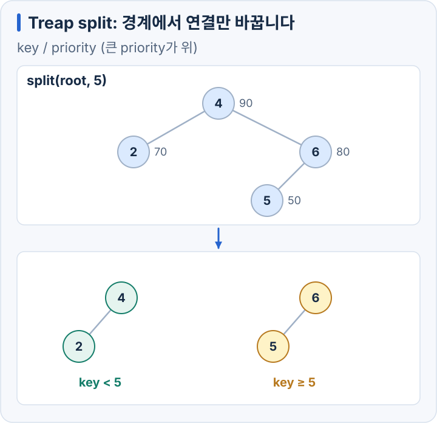

# Treap과 BST 기본

Treap은 직접 구현하기 쉬운 randomized balanced BST입니다. `key`로 탐색 순서를, 무작위 `priority`로 트리의 모양을 정합니다.

BST는 Binary Search Tree, 즉 이진 탐색 트리입니다. 각 노드는 왼쪽 subtree에 더 작은 key를, 오른쪽 subtree에 더 큰 key를 둡니다.

```text
left subtree의 모든 key < root key < right subtree의 모든 key
```

이 조건 덕분에 탐색, 삽입, 삭제를 트리 높이에 비례해서 처리할 수 있습니다. 문제는 트리 높이입니다. 균형이 잘 잡히면 `O(log n)`이지만, 한쪽으로 기울면 `O(n)`이 됩니다.

```text
균형 잡힌 BST:       기울어진 BST:

      4                 1
    /   \                \
   2     6                2
  / \   / \                \
 1   3 5   7                3
                              \
                               4
```

균형 BST는 이 문제를 해결하려는 자료구조입니다. Treap은 각 노드에 무작위 `priority`를 붙여 트리 모양을 입력 순서에 덜 민감하게 만들고, 기대 `O(log n)`에 삽입, 삭제, 탐색, 순위 질의를 처리합니다.

BST를 왼쪽 자식, 현재 노드, 오른쪽 자식 순으로 방문하면 key가 오름차순으로 나옵니다. Treap은 이 순서를 유지한 채 priority로 부모를 정합니다.


## Treap 노드와 size

순위 질의와 k번째 원소를 처리하려면 각 subtree 크기를 저장합니다.

> **코드 환경: h-contest 제출용 코드.** [공통 코드](https://h.readiz.com/learn/cpp-common-library)의 `random` 블록(`hc::Random`)을 먼저 붙입니다. 표준 헤더·STL·동적 할당 없이 고정 크기 풀 배열로 구현합니다.

포인터 대신 `pool` 배열의 번호를 씁니다. 노드 번호는 `1`부터 쓰고 `0`은 빈 트리(없는 자식)입니다. `MAX_NODES`는 한 TC에서 만드는 노드 수의 상한이며, 이 사이트 연습의 입력 상한입니다. 실제 문제에서는 제한에 맞춰 바꿉니다. 큰 `pool`은 전역으로 두고, TC가 시작될 때마다 `initTreap(seed)`로 `poolSize`를 `0`으로 되돌리고 난수 seed를 다시 정합니다. 이전 TC의 노드 값은 `newNode`가 덮어쓰므로 `pool`을 따로 지울 필요는 없습니다.

```cpp
const int MAX_NODES = 200000; // 한 TC에서 만드는 노드 수 상한

struct Node {
    int key;
    unsigned priority;
    int size;
    int left;
    int right;
};

Node pool[MAX_NODES + 1]; // 0번은 쓰지 않는다(빈 트리)
int poolSize;
hc::Random rng;

void initTreap(unsigned seed) {
    poolSize = 0;
    rng.reset(seed);
}

int newNode(int key) { // pool이 가득 차면 0
    if (poolSize >= MAX_NODES) return 0;
    poolSize++;
    pool[poolSize].key = key;
    pool[poolSize].priority = rng.next();
    pool[poolSize].size = 1;
    pool[poolSize].left = 0;
    pool[poolSize].right = 0;
    return poolSize;
}

int getSize(int node) {
    return node ? pool[node].size : 0;
}

void pull(int node) {
    if (!node) return;
    pool[node].size = 1 + getSize(pool[node].left) + getSize(pool[node].right);
}
```

`priority`는 입력 key와 독립적으로 `rng.next()`가 뽑습니다. seed를 고정하면 같은 입력에서 같은 트리가 만들어집니다. 자식을 바꾼 뒤에는 항상 `pull(node)`로 `size`를 다시 계산합니다.

## Treap merge

`merge(a, b)`는 두 Treap을 하나로 합칩니다. 단, `a`의 모든 key가 `b`의 모든 key보다 작아야 합니다.

```cpp
int merge(int a, int b) {
    if (!a) return b;
    if (!b) return a;

    if (pool[a].priority > pool[b].priority) {
        pool[a].right = merge(pool[a].right, b);
        pull(a);
        return a;
    } else {
        pool[b].left = merge(a, pool[b].left);
        pull(b);
        return b;
    }
}
```

BST 조건은 `a < b` 전제 때문에 유지됩니다. Heap 조건은 priority가 높은 쪽을 root로 고르기 때문에 유지됩니다.

## Treap split



[그림 크게 보기](https://git.readiz.com/h-contest-lesson/lessons/treap/lesson-assets/structure-trace.svg)

4는 왼쪽 결과에 남기고 오른쪽 자식 6을 재귀로 나눕니다. 6의 왼쪽 5도 오른쪽 결과이므로, 4의 오른쪽 연결만 비게 됩니다. 다시 merge하면 priority에 따라 원래 구조가 복원됩니다.

`split(root, key, a, b)`는 하나의 Treap을 두 개로 나눕니다.

```text
a: key보다 작은 원소들
b: key 이상인 원소들
```

```cpp
void split(int root, int key, int& a, int& b) {
    if (!root) {
        a = 0;
        b = 0;
        return;
    }

    if (pool[root].key < key) {
        split(pool[root].right, key, pool[root].right, b);
        a = root;
        pull(a);
    } else {
        split(pool[root].left, key, a, pool[root].left);
        b = root;
        pull(b);
    }
}
```

`pool[root].key < key`이면 root와 왼쪽 subtree는 전부 `a` 쪽에 남을 수 있습니다. 오른쪽 subtree에는 작은 값과 큰 값이 섞여 있을 수 있으므로 오른쪽만 다시 나눕니다.

## Treap 삽입과 삭제

삽입은 split 후 가운데에 새 노드를 끼우고 다시 merge합니다. `node`는 `newNode(key)`가 돌려준 독립 노드 번호입니다.

```cpp
int insert(int root, int node) {
    int left = 0;
    int right = 0;
    split(root, pool[node].key, left, right);
    return merge(merge(left, node), right);
}
```

이 삽입 함수는 같은 key가 아직 없다는 전제로 호출합니다. 중복이 가능한 입력이면 key를 비교하며 트리를 탐색해 존재 여부를 먼저 확인하거나 `(value, id)`처럼 유일한 키를 사용합니다. 중복 검사는 `newNode` 전에 해야 풀 칸을 낭비하지 않습니다.

삭제는 찾은 노드를 제거하고, 그 노드의 왼쪽 subtree와 오른쪽 subtree를 merge합니다.

```cpp
int erase(int root, int key) {
    if (!root) return 0;

    if (pool[root].key == key) {
        return merge(pool[root].left, pool[root].right);
    }

    if (key < pool[root].key) {
        pool[root].left = erase(pool[root].left, key);
    } else {
        pool[root].right = erase(pool[root].right, key);
    }

    pull(root);
    return root;
}
```

왼쪽 subtree의 모든 key는 삭제된 key보다 작고, 오른쪽 subtree의 모든 key는 더 큽니다. 그래서 `merge(left, right)`의 전제가 맞습니다. 삭제된 노드는 트리에서만 빠지고 `pool`에 남으므로 `MAX_NODES`는 현재 원소 수가 아니라 한 TC의 **총 삽입 횟수** 이상이어야 합니다.

## 순위와 k번째 원소

`orderOfKey(x)`는 `x`보다 작은 원소 개수를 반환합니다.

```cpp
int orderOfKey(int root, int key) {
    if (!root) return 0;

    if (key <= pool[root].key) {
        return orderOfKey(pool[root].left, key);
    }
    return getSize(pool[root].left) + 1 + orderOfKey(pool[root].right, key);
}
```

`kth(root, k)`는 0-indexed로 k번째 작은 원소를 반환합니다. 호출부에서 `0 <= k < getSize(root)`인지 확인해야 합니다.

```cpp
int kth(int root, int k) {
    int leftSize = getSize(pool[root].left);

    if (k < leftSize) {
        return kth(pool[root].left, k);
    }
    if (k == leftSize) {
        return pool[root].key;
    }
    return kth(pool[root].right, k - leftSize - 1);
}
```

둘 다 subtree 크기만 보고 한쪽으로 내려가므로 기대 `O(log n)`입니다.

## 로컬 연습: 중복 없는 집합의 순위와 k번째 값

I x는 값 삽입, D x는 삭제, R x는 x보다 작은 값의 수, K k는 0-based k번째 작은 값을 묻습니다. 이미 있는 값 삽입과 없는 값 삭제는 집합을 바꾸지 않습니다.

**입력:** Q 뒤 Q개 연산. 0 <= Q <= 200000, |x| <= 10^9, 0 <= k <= Q입니다.

**출력:** R과 K의 답을 출력합니다. k가 현재 크기 이상이면 INVALID를 출력합니다.

### 예시

```text exercise=treap role=input
11
I 5
I 2
I 8
I 5
R 5
K 1
D 5
K 1
D 7
R 9
K 2
```

```text exercise=treap role=output
1
5
8
2
INVALID
```

**확인 방법:** 중복 key는 새 노드를 만들기 전에 검사하고, 삽입 횟수가 `MAX_NODES`를 넘지 않는지 확인합니다. R은 왼쪽 subtree 크기를 누적하며 탐색합니다. 작은 입력은 정렬된 vector/set 기준 풀이와 대조하고 빈 트리·root 삭제·오름차순 삽입·동일 key 반복을 검사합니다.

## 휴리스틱 풀이에서 쓰는 곳

휴리스틱 대회에서 Treap은 드물게 씁니다. 순서를 바꾸는 탐색(구간 뒤집기, 원소 이동)이 많은 경로 문제에서 후보가 될 수 있지만, 확인한 공개 문제의 크기가 작습니다. [미니 물품 배송](/practice/ORDERING)은 `n`이 최대 100, [맨해튼 TSP](/practice/TSPTESTX)는 `n`이 12~32라서 배열을 직접 뒤집어도 비용이 작습니다.

`n`이 수만 이상으로 커져 배열 뒤집기 비용이 병목이 될 때 트리 기반 순서 구조를 검토합니다. 그 전에는 배열과 차분 평가로 충분한지 먼저 확인합니다.
