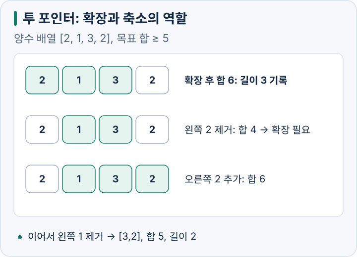
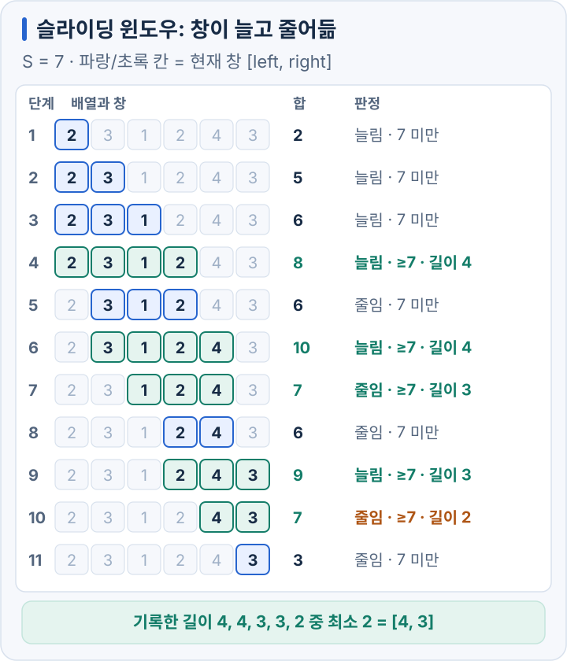

# 투 포인터와 슬라이딩 윈도우

투 포인터는 배열이나 문자열에서 두 위치를 움직이며 필요한 구간이나 쌍을 찾는 방법입니다. 모든 쌍을 `O(n^2)`으로 보지 않고, 포인터가 한 방향으로만 움직이게 만들어 `O(n)` 또는 `O(n log n)`으로 줄이는 것이 핵심입니다.

## 언제 필요한가

아래 신호가 보이면 투 포인터를 먼저 의심합니다.

- 정렬된 배열에서 합이 특정 값이 되는 두 수를 찾는다.
- 연속 구간의 합, 길이, 종류 수를 묻는다.
- 오른쪽 끝을 늘리면 조건이 좋아지거나 나빠지는 방향이 일정하다.
- 같은 원소를 여러 번 세지 않으면서 모든 후보 구간을 훑어야 한다.

핵심은 **한 포인터가 되돌아가지 않아도 되는가**입니다. 왼쪽 포인터와 오른쪽 포인터가 각각 최대 `n`번만 움직이고 이동당 갱신이 `O(1)`이면 전체 시간은 `O(n)`입니다.

## 정렬된 배열에서 양끝 포인터

정렬된 배열에서 두 수의 합을 확인할 때는 왼쪽 끝과 오른쪽 끝에서 시작합니다.

```text
a[l] + a[r] < target 이면 l을 오른쪽으로 이동
a[l] + a[r] > target 이면 r을 왼쪽으로 이동
```

정렬되어 있기 때문에 `l`을 오른쪽으로 옮기면 합은 커지고, `r`을 왼쪽으로 옮기면 합은 작아집니다.

> **코드 환경: h-contest 제출용 코드.** [공통 코드](https://h.readiz.com/learn/cpp-common-library)의 `sort` 블록을 먼저 붙입니다. 표준 헤더·STL·동적 할당 없이 호출자가 준비한 배열과 길이 `n`을 받습니다. 상한 `MAX_N = 200000`은 이 강의 연습의 입력 상한이며 실제 문제의 제한에 맞춰 바꿉니다. 전역 배열을 쓰는 함수(마지막 예제)는 호출할 때마다 사용할 `[0, n)`을 스스로 초기화하므로 TC마다 따로 비울 필요가 없습니다.

`hasPairWithSum`은 정렬하려고 `a`를 **제자리에서 오름차순 정렬**합니다(호출자의 배열이 바뀝니다). `temp`는 `a`와 겹치지 않는 `n`칸 이상의 배열입니다.

```cpp
const int MAX_N = 200000; // 배열 길이 상한

bool intBefore(int a, int b) {
    return a < b;
}

bool hasPairWithSum(int a[], int temp[], int n, int target) {
    hc::stableSort(a, temp, n, intBefore);
    int l = 0;
    int r = n - 1;
    while (l < r) {
        long long sum = (long long)a[l] + a[r];
        if (sum == target) return true;
        if (sum < target) l++;
        else r--;
    }
    return false;
}
```

## 조건을 만족하는 가장 짧은 구간



[그림 크게 보기](https://git.readiz.com/h-contest-lesson/lessons/two-pointers-sliding-window/lesson-assets/concept-trace.svg)

모든 값이 양수라면 오른쪽 끝을 늘릴수록 구간 합은 커지고, 왼쪽 끝을 줄일수록 구간 합은 작아집니다. 이 단조성 덕분에 합이 `target` 이상인 가장 짧은 연속 구간을 `O(n)`에 찾을 수 있습니다.

```cpp
int minLengthAtLeastSum(const int a[], int n, long long target) {
    int answer = n + 1;
    int left = 0;
    long long sum = 0;

    for (int right = 0; right < n; right++) {
        sum += a[right];
        while (left <= right && sum >= target) {
            if (right - left + 1 < answer) answer = right - left + 1;
            sum -= a[left];
            left++;
        }
    }

    return answer == n + 1 ? -1 : answer;
}
```

값에 음수가 섞이면 오른쪽을 늘렸을 때 합이 항상 커지지 않습니다. 그때는 누적합 + 자료구조, prefix minimum, deque 같은 다른 도구가 필요할 수 있습니다.

## 조건을 만족하는 가장 긴 구간

구간 안의 서로 다른 값 개수, 최대 빈도, 합의 상한처럼 "오른쪽을 늘리면 조건이 깨질 수 있고, 왼쪽을 줄이면 회복된다"는 형태도 자주 나옵니다.

값의 범위가 크면 값 자체를 배열 인덱스로 쓸 수 없습니다. STL 해시 대신 [좌표 압축](https://h.readiz.com/learn/coordinate-compression)처럼 값을 정렬·중복 제거해 `0..m-1`번호로 바꾼 뒤, 번호별 등장 횟수를 배열로 셉니다. 서로 다른 값의 수는 `distinct`로 직접 유지합니다. 아래 함수는 호출할 때마다 `freq[0..m)`을 0으로 채우고, `n`이 `0..MAX_N` 밖이면 `-1`을 반환합니다. `rankOf`는 `sortedValues`에서 값의 위치를 이분 탐색으로 찾습니다.

```cpp
int sortedValues[MAX_N], sortTemp[MAX_N], rankedA[MAX_N], freq[MAX_N];

int rankOf(int m, int x) { // sortedValues[0..m)에서 x의 위치. 전제: x가 들어 있다.
    int low = 0;
    int high = m;
    while (low < high) {
        int mid = low + (high - low) / 2;
        if (sortedValues[mid] < x) low = mid + 1;
        else high = mid;
    }
    return low;
}

int longestAtMostKDistinct(const int a[], int n, int k) {
    if (n < 0 || n > MAX_N) return -1; // 전역 작업 배열 상한
    if (k <= 0) return 0;
    for (int i = 0; i < n; ++i) sortedValues[i] = a[i];
    hc::stableSort(sortedValues, sortTemp, n, intBefore);
    int m = 0;
    for (int i = 0; i < n; ++i)
        if (m == 0 || sortedValues[i] != sortedValues[m - 1]) sortedValues[m++] = sortedValues[i];
    for (int i = 0; i < n; ++i) rankedA[i] = rankOf(m, a[i]);
    for (int i = 0; i < m; ++i) freq[i] = 0;

    int distinct = 0;
    int left = 0;
    int answer = 0;

    for (int right = 0; right < n; right++) {
        if (freq[rankedA[right]]++ == 0) distinct++;
        while (distinct > k) {
            if (--freq[rankedA[left++]] == 0) distinct--;
        }
        if (right - left + 1 > answer) answer = right - left + 1;
    }

    return answer;
}
```

창을 움직이는 부분은 `O(n)`이고, 값을 번호로 바꾸는 정렬과 이분 탐색이 `O(n log n)`이므로 전체는 `O(n log n)`입니다.

`while` 조건에는 "현재 창이 유효하지 않은 동안"을 넣습니다. 유효해진 뒤에 답을 갱신하면 창이 항상 문제 조건을 만족합니다.

## 로컬 연습: 목표 합 이상인 가장 짧은 구간

양수 배열에서 합이 S 이상인 연속 구간의 최소 길이를 구하세요. 그런 구간이 없으면 0입니다.

**입력:** N S와 길이 N의 배열. 1 <= N <= 200000, 1 <= a[i] <= 1000000, 1 <= S <= 10^12입니다.

**출력:** 최소 길이 하나를 출력합니다.

### 예시

```text exercise=two-pointers-sliding-window role=input
6 7
2 3 1 2 4 3
```

```text exercise=two-pointers-sliding-window role=output
2
```

**확인 방법:** 마지막 [4,3]의 길이가 2입니다. N <= 30에서 모든 구간을 열거해 비교합니다. 한 원소가 바로 S 이상인 경우와 전체 합이 S보다 작은 경우를 검사합니다. 음수 입력으로 바꾼 경우에는 창의 단조성이 유지되지 않습니다.



[그림 크게 보기](https://git.readiz.com/h-contest-lesson/lessons/two-pointers-sliding-window/lesson-assets/window-trace.svg)

위의 연습 예시를 단계별로 펼친 그림입니다. 초록 칸은 합이 7 이상인 창이며, 왼쪽을 줄이는 동안에도 합이 다시 7 미만이 되는 순간까지 길이를 기록합니다.

## 휴리스틱 풀이에서 쓰는 곳

두 포인터는 정렬된 열을 한 번씩만 훑으며 "지금 유효한 집합"을 유지하는 데 씁니다. 시간 구간이나 거리 범위처럼 한쪽이 늘고 다른 쪽이 줄어드는 상황에서 매번 전체를 다시 검사하지 않게 해 줍니다. 후보를 걸러내는 단계에서 쓰이는 경우가 많고 풀이 전체를 좌우하는 도구는 아닙니다.

- [텐서 할당](/practice/TENSORALLOC): 두 텐서는 `a.start < b.end && b.start < a.end`일 때 시간이 겹칩니다. 텐서를 `start` 순과 `end` 순으로 각각 정렬해 두고 두 포인터로 훑으면, 현재 시각에 아직 끝나지 않은 텐서의 집합을 한 번씩만 추가하고 제거하며 유지할 수 있습니다. 텐서가 3000~5000개이므로 모든 쌍을 비교해도 되지만, 배치를 여러 번 다시 평가하는 단계에서는 이 방식이 유리합니다.

이 사이트의 공개 문제 중 슬라이딩 윈도우가 핵심인 문제는 확인하지 못했습니다. 연속 구간의 조건이 단조로울 때만 쓸 수 있으므로, 구간을 늘리면 조건이 한 방향으로만 변하는지 먼저 확인합니다.
