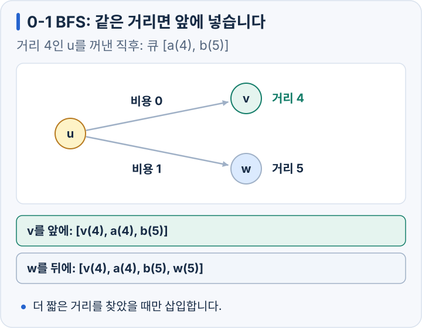
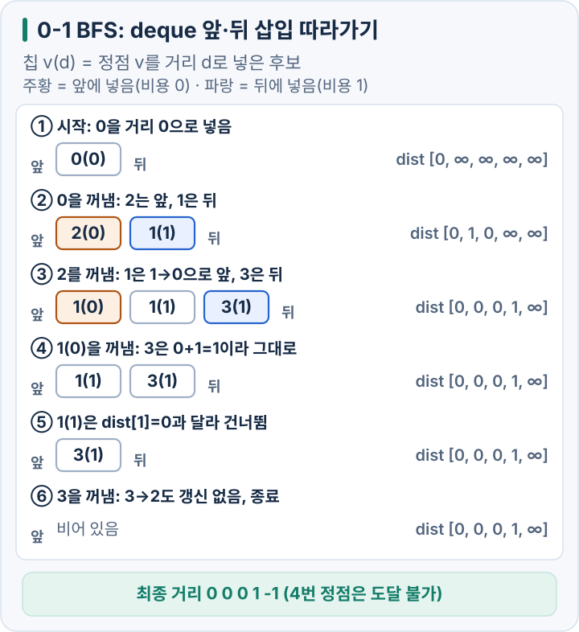

# 0-1 BFS

0-1 BFS는 간선 비용이 `0` 또는 `1`인 그래프에서 최단거리를 구하는 알고리즘입니다. 일반 BFS처럼 큐를 쓰지만, 비용이 0인 이동은 앞에 넣고 비용이 1인 이동은 뒤에 넣기 위해 `deque`를 사용합니다.

## 간선 비용이 0 또는 1일 때

일반 BFS는 모든 간선 비용이 1일 때만 최단거리를 보장합니다. 비용이 0인 간선이 섞이면, 한 번 이동했는데 거리 증가가 없을 수 있습니다.

```text
u --0--> v  거리 증가 없음
u --1--> w  거리 1 증가
```

이때 Dijkstra를 써도 됩니다. 하지만 비용이 0과 1뿐이라면 우선순위 큐 대신 deque만으로 더 간단하게 처리할 수 있습니다.

## deque를 쓰는 이유



[그림 크게 보기](https://git.readiz.com/h-contest-lesson/lessons/zero-one-bfs/lesson-assets/structure-trace.svg)

괄호는 정점의 거리 후보입니다. 두 이웃의 기존 거리가 더 컸다고 가정하면 비용 0의 v는 현재 거리 층에, 비용 1의 w는 다음 거리 층에 들어갑니다.

현재 정점 `u`에서 이웃 `v`로 가는 비용이 `0`이면 `dist[v]`는 `dist[u]`와 같습니다. 이 정점은 지금 처리 중인 거리 그룹과 같은 우선순위이므로 deque 앞쪽에 넣습니다.

비용이 `1`이면 다음 거리 그룹이므로 뒤쪽에 넣습니다.

```text
cost 0: pushFront
cost 1: pushBack
```

이렇게 하면 deque의 앞쪽에는 항상 현재까지 가장 작은 거리 후보가 옵니다.



[그림 크게 보기](https://git.readiz.com/h-contest-lesson/lessons/zero-one-bfs/lesson-assets/deque-trace.svg)

간선은 `0→1:1, 0→2:0, 2→1:0, 1→3:1, 2→3:1, 3→2:0`입니다. 2를 꺼낸 뒤 1의 거리가 1에서 0으로 줄어 앞에 다시 들어가므로 뒤에 남은 `1(1)`은 낡은 후보가 됩니다.

## 기본 구현

> **코드 환경: h-contest 제출용 코드.** [공통 코드](https://h.readiz.com/learn/cpp-common-library)에는 deque 블록이 없어서 이 강의에 최소형을 둡니다. 표준 헤더·STL·동적 할당 없이 고정 배열로 구현하며, 아래 두 블록을 이어서 사용합니다.

그래프는 간선 번호로 연결하는 `head`/`next` 배열 인접 리스트입니다([BFS/DFS 강의](https://h.readiz.com/learn/bfs-dfs-grid)와 같은 형태에 `cost`를 더함). 상한은 이 강의 연습의 입력 상한인 정점 `MAX_V = 200000`, 간선 `MAX_E = 400000`이며 실제 문제에서는 제한에 맞춰 바꿉니다. 큰 `Graph`와 deque는 전역으로 두고, TC마다 `graph.init(n)`을 호출합니다. deque는 `zeroOneBfs` 안에서 비웁니다.

deque는 고리 배열로 만듭니다. 한 정점은 거리가 줄어들 때마다 들어가고, 아래 설명처럼 같은 정점이 최대 두 번까지만 들어가므로 동시에 들어 있는 항목은 `2 * MAX_V`개 이하입니다. 가득 차서 `pushFront`·`pushBack`이 실패하면 입력 전제(비용이 0 또는 1)가 깨진 것이므로 `false`를 반환합니다.

```cpp
const int MAX_V = 200000; // 정점 수 상한
const int MAX_E = 400000; // 방향 간선 수 상한
const int INF = 1000000000;

struct Graph {
    int head[MAX_V];
    int next[MAX_E];
    int to[MAX_E];
    int cost[MAX_E]; // 0 or 1
    int edgeCount;

    void init(int n) { // 전제: 0 <= n <= MAX_V
        for (int i = 0; i < n; ++i) head[i] = -1;
        edgeCount = 0;
    }
    bool addEdge(int u, int v, int c) { // 간선이 가득 차면 false
        if (edgeCount == MAX_E) return false;
        to[edgeCount] = v;
        cost[edgeCount] = c;
        next[edgeCount] = head[u];
        head[u] = edgeCount++;
        return true;
    }
};

template<int CAP> struct Deque {
    int data[CAP];
    int first, count; // 앞 칸의 위치와 항목 수
    void clear() { first = count = 0; }
    bool pushBack(int value) {
        if (count == CAP) return false;
        data[(first + count) % CAP] = value;
        ++count;
        return true;
    }
    bool pushFront(int value) {
        if (count == CAP) return false;
        first = (first + CAP - 1) % CAP;
        data[first] = value;
        ++count;
        return true;
    }
    bool popFront(int& value) {
        if (count == 0) return false;
        value = data[first];
        first = (first + 1) % CAP;
        --count;
        return true;
    }
};
```

`dist[0..n)`은 함수가 채우며, 전제는 `0 <= start < n <= MAX_V`입니다. 범위를 벗어나면 `false`를 반환합니다.

```cpp
Deque<2 * MAX_V> dq;

bool zeroOneBfs(const Graph& graph, int n, int start, int dist[]) {
    if (n < 0 || n > MAX_V || start < 0 || start >= n) return false;
    for (int i = 0; i < n; ++i) dist[i] = INF;
    dq.clear();

    dist[start] = 0;
    dq.pushBack(start);

    int u;
    while (dq.popFront(u)) {
        for (int k = graph.head[u]; k != -1; k = graph.next[k]) {
            int to = graph.to[k];
            int cost = graph.cost[k];
            int nd = dist[u] + cost;
            if (nd >= dist[to]) continue;
            dist[to] = nd;
            if (!(cost == 0 ? dq.pushFront(to) : dq.pushBack(to))) return false;
        }
    }

    return true;
}
```

일반 BFS처럼 처음 발견한 순간 방문을 확정하지 않습니다. 더 짧은 0비용 경로가 나중에 발견될 수 있어 같은 정점이 deque에 여러 번 들어갈 수 있습니다. deque에 넣은 거리 후보는 두 인접 거리 층으로 정렬됩니다. 한 정점은 같은 층의 0비용 경로로 한 번 더 개선될 수 있지만 반복 개선이 누적되지는 않아 전체 복잡도는 `O(V + E)`입니다.

## 격자 상태 그래프 예시

방향을 바꾸는 비용이 1이고, 같은 방향으로 가는 비용이 0인 격자 문제를 생각해 봅시다. 상태는 `(r, c, dir)`이고, 이동 비용은 방향이 바뀌는지에 따라 정합니다.

이런 문제는 단순 칸 방문 배열로는 부족합니다. 같은 칸이라도 어떤 방향으로 들어왔는지에 따라 다음 비용이 달라지므로 방향까지 상태에 포함해야 합니다.

## 시간 복잡도

| 작업 | 시간 |
| --- | --- |
| 초기화 | `O(V)` |
| 간선 relax 전체 | `O(E)` |
| deque 삽입/삭제 | `O(V + E)` |
| 전체 | `O(V + E)` |
| 메모리 | `O(V + E)` |

## 로컬 연습: 무료 간선과 유료 간선

방향 그래프에서 시작점부터 모든 정점까지의 최소 비용을 구하세요. 간선 비용은 0 또는 1입니다.

**입력:** N M S 뒤 M줄의 u v w. 1 <= N <= 200000, 0 <= M <= 400000, 정점은 0-based입니다. 중복 간선과 self-loop를 허용합니다.

**출력:** 정점 번호순 최소 비용을 한 줄에 출력하고 도달 불가 정점은 -1로 표시합니다.

### 예시

```text exercise=zero-one-bfs role=input
5 6 0
0 1 1
0 2 0
2 1 0
1 3 1
2 3 1
3 2 0
```

```text exercise=zero-one-bfs role=output
0 0 0 1 -1
```

**확인 방법:** 0→2→1은 비용 0입니다. 작은 입력은 Dijkstra와 비교합니다. 비용 0의 cycle, 더 비싼 경로로 먼저 발견되는 정점, 고립 정점을 검사합니다. 최초 발견만으로 거리를 확정하지 말고 더 짧아질 때 갱신합니다.

## 휴리스틱 풀이에서 쓰는 곳

휴리스틱 대회에서 0-1 BFS는 드물게 씁니다. 간선 비용이 정확히 0 또는 1로 떨어질 때만 맞는 도구이기 때문입니다. 확인한 공개 문제 중 [로봇 청소기](/practice/ROBOTCLEAN)는 이동 10, 회전 15, 스캔 20으로 비용이 0과 1이 아니어서 맞지 않습니다. 이런 경우에는 먼저 [Dijkstra](https://h.readiz.com/learn/dijkstra)나 단순 BFS를 검토합니다.

비용을 "이동 횟수"로만 단순화해도 되는 경우라면 일반 BFS로 충분하고, 방향 전환 같은 일부 간선만 공짜로 모델링할 수 있을 때에 한해 0-1 BFS를 고려합니다.
